# 字面重叠偏差：中文教材问答中检索模型的分析与改进

> 初稿。标【待补】的地方需要人工抽查、手写测试题的结果和 demo 截图，图片在 `../figures/`。

## 摘要

检索增强生成（RAG）系统先从知识库里找出相关段落，再让大模型根据段落回答。检索一旦找错，后面的回答就会出错。本文发现，在中文教材问答中，检索模型严重依赖"问题和答案段落用了相同的字"：同一个模型，在字面重叠率高的题上排第一的正确率可达 0.86，换成不熟悉术语的人用大白话提问，就降到 0.03–0.23。

本文以《动手学深度学习》中文版的 6 章（376 个段落）为知识库，用大模型生成 1484 道题，其中一半要求避开原文用词，并按章节划分训练集和测试集。在此基础上依次比较：BM25、5 个现成向量模型、对比学习微调（含难负样本）和重排模型（reranker），并且每个实验都按字面重叠率分组报告结果。主要发现如下：

1. 所有方法都随字面重叠率下降而明显变差；模型参数量从 2400 万增加到 5.7 亿，低重叠组的 R@1 只从 0.11 升到 0.23。
2. 只用 724 道训练题做对比学习微调，bge-base 在低重叠组的 R@1 从 0.198 升到 0.310，超过大 6 倍的 bge-m3；专门挑选的难负样本没有带来超出随机波动的额外提升。
3. reranker 把整体 R@1 提高到 0.671，但它在高重叠组提升 0.18，在低重叠组只提升 0.02，字面偏差反而扩大。
4. 错误分析显示，最好系统的 187 道错题中，有 87 道（47%）可以确定是被字面相似的错误段落误导；在低重叠组这一比例为 61%。
5. 在百度真实搜索数据 DuRetrieval（10 万段落）上，同样的偏差也存在；在教材上微调的模型换到这个领域后成绩只下降 0.012（R@1 0.867 → 0.855）。

## 1 引言

### 1.1 一个例子

用向量模型 bge-small 给问题"高数挂科怎么办"找答案时，"高数课本第三章……"（相似度 0.550）排在了真正的答案"微积分不及格……可以参加补考"（0.519）前面。两句话的区别只在于前者和问题共用了"高数"两个字。把问题里的"高数"换成"线代"，干扰句的相似度降到 0.317；在答案句里加上"高数"，答案的相似度升到 0.673。

这个例子说明，模型给出的"相似"在很大程度上是字面相似，并不完全是意思相近。本文把这种现象称为**字面重叠偏差**。

### 1.2 为什么这个问题重要

课程问答助手的使用者大多是刚开始学的学生。他们还不熟悉教材里的术语，经常用自己的话描述问题，例如把"全连接层"说成"把所有位置都连起来的那种层"。对这类提问，依赖字面匹配的检索会系统性地失败，而这正是学生最需要帮助的时候。

### 1.3 本文的工作

- **数据层面**：构建一个带"字面重叠率"标注的中文教材检索数据集，包含两类大模型生成的题目，统计它们和真人搜索提问的重叠率分布。
- **方法层面**：对比 BM25、5 个向量模型、对比学习微调（±难负样本）和 reranker；手写 InfoNCE 训练循环。
- **分析层面**：每个实验都按重叠率分组报告；对错题按"是否被字面误导"分类统计；在外部数据集上验证结论。

## 2 任务定义与评价指标

**任务**：给定一个问题，从知识库的全部段落中按相关程度排序，正确段落排得越靠前越好。每道题有一个标注的正确段落。

**字面重叠率**：问题中出现的不同汉字里，有多大比例也出现在答案段落中。例如问题有 20 个不同汉字，其中 16 个出现在答案段落里，重叠率就是 0.8。本文按重叠率把题目分成三组：低重叠（< 0.5）、中重叠（0.5–0.8）、高重叠（≥ 0.8）。

**评价指标**：

- **R@k**（Recall@k）：正确段落排进前 k 名的题目比例。R@1 就是"排第一的正好是正确段落"的比例，是本文的主要指标。
- **MRR**（平均倒数排名）：正确段落排第 1 名记 1 分，第 2 名记 1/2 分，第 5 名记 1/5 分，取所有题的平均值。

## 3 数据

### 3.1 知识库：d2l-zh 教材

知识库取自《动手学深度学习》中文版（d2l-zh，Apache-2.0 许可），选取和本课程课件 ML2–ML11 对应的 6 章：引言、线性神经网络、多层感知机、卷积神经网络、现代卷积神经网络、计算机视觉。课程课件本身几乎全是英文，文字量也少，不适合直接当知识库。

**清洗**（`step1_chunk_d2l.py`）：去掉代码块、独立公式（替换为"（公式略）"）、图片、交叉引用标记和每节末尾的练习题；跳过从零实现、简洁实现、Kaggle 比赛、数据集下载这类以代码为主的小节，以及英文原文文件。

**切分**：按自然段累积，达到约 300 个汉字就切一段；少于 60 个汉字的段落并入前一段。每段带上所在小节的标题路径，例如"锚框 > 使用非极大值抑制预测边界框"。最终得到 **376 个段落**，长度中位数 341 字（最短 78 字，最长 1340 字），见图 1。

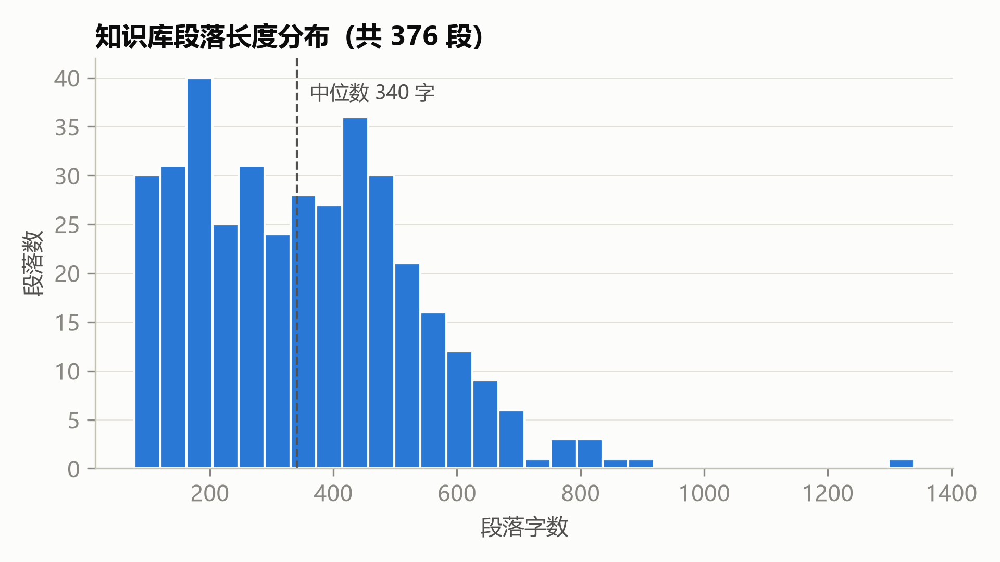

### 3.2 生成题目

人工给 376 个段落出题的成本太高，本文用大模型 DeepSeek（实际返回的模型为 deepseek-flash）给每个段落出 4 道题（`step2_gen_questions.py`），共用约 19 万 token：

- **plain 题 2 道**：常规出题方式，要求答案能在段落中找到。这是业界常见的做法。
- **paraphrase 题 2 道**：要求假设提问者没读过这本书，用大白话描述想知道的内容，尽量不用段落里的原词和术语。

两类题平均长度分别为 26.6 和 39.4 字。paraphrase 题更长，因为提问者要用描述代替术语。

**过滤**（`step3_build_dataset.py`）：去掉含"本段""文中""上述"等指代原文的题目。1504 道题中保留了 **1484 道**。

### 3.3 划分训练集和测试集

如果训练题和测试题出自同一个段落，甚至同一章，模型就可能靠记住这一章的内容取得高分，测试成绩会偏高。所以本文**按章划分**（图 2）：

| 划分 | 章节 | 题数 | 段落数 |
|---|---|---|---|
| 训练集 | 引言、线性神经网络、多层感知机 | 724 | 184 |
| 验证集 | 卷积神经网络 | 192 | 48 |
| 测试集 | 现代卷积神经网络、计算机视觉 | 568 | 144 |

检索时，每道题都在全部 376 个段落中查找，不只在本章里找。

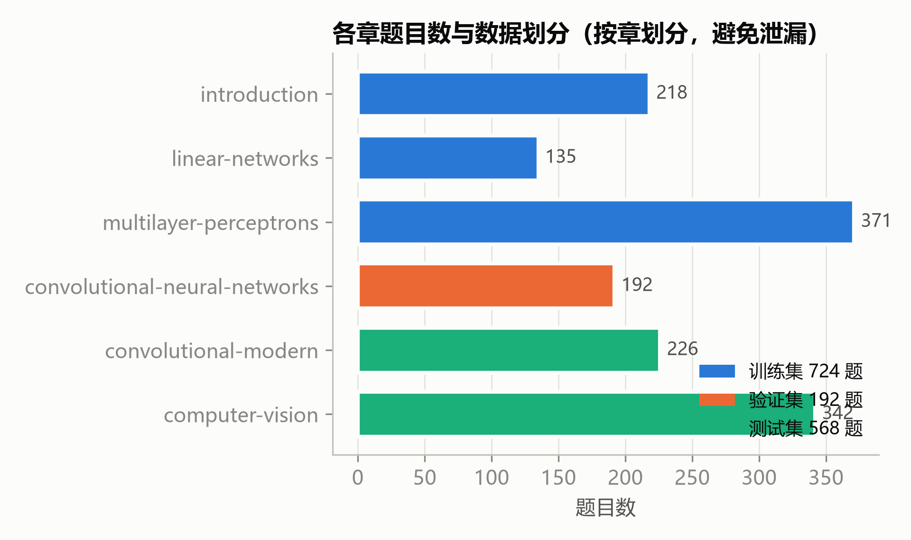

### 3.4 字面重叠率统计

图 3 比较了三类问题的重叠率分布：

| 问题来源 | 题数 | 重叠率均值 | 中位数 | 低重叠（<0.5）占比 |
|---|---|---|---|---|
| 大模型 plain 题 | 741 | 0.84 | 0.86 | 0.3% |
| 大模型 paraphrase 题 | 743 | 0.52 | 0.53 | 40.2% |
| 真人搜索提问（DuRetrieval） | 2000 | 0.86 | — | 5.3% |

DuRetrieval 每道题平均有 5 个正确段落，这里取和问题最像的那个计算。

有两点值得注意：

1. **常规出题方式的题目几乎都是高重叠的**，只有 0.3% 低于 0.5。如果只用这类题评估，会掩盖检索模型在换说法提问上的问题。
2. **百度搜索的真人提问重叠率同样很高**（0.86）。原因是搜索问题短，正确段落又是从搜索结果里挑出来的，天然和问题用词接近。这说明现有公开数据集也很少覆盖"不知道术语怎么说"的提问，paraphrase 题补上了这一块。

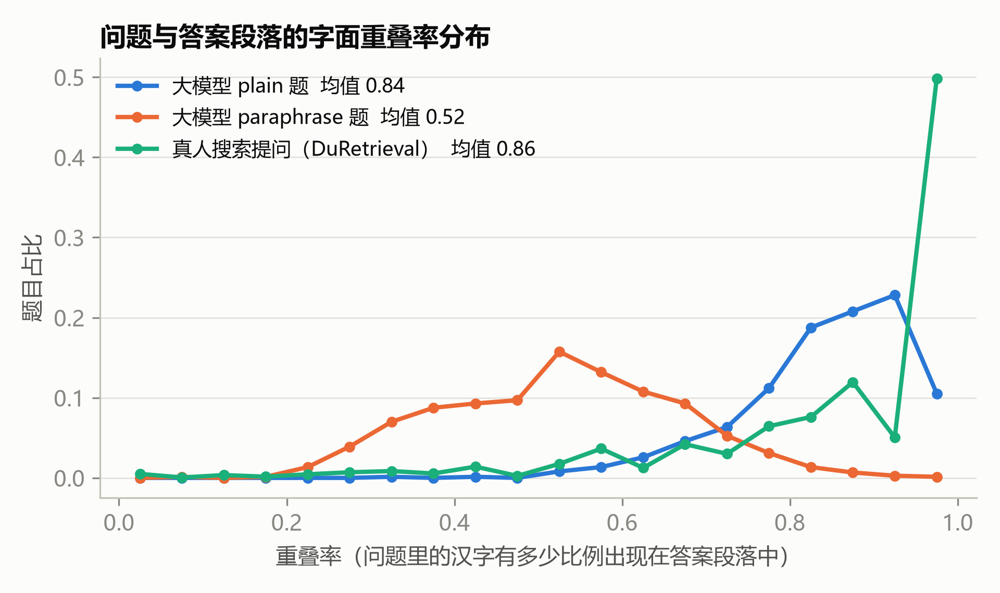

### 3.5 数据质量验证

【待补】从测试集随机抽取 100 道题（plain、paraphrase 各 50 道），人工判断两项：答案是否确实在标注的段落里；题目是否像真人会问的。结果：答案正确率 __%，像真人提问 __%。

【待补】另外手写 __ 道真实测试题，模拟学生提问，统计其重叠率并作为补充测试集。

## 4 方法

### 4.1 BM25

BM25 是传统的关键词检索方法：问题里的词在段落中出现得越多，得分越高；在所有段落里都常见的词（如"的""是"）权重低，少见的词权重高。中文需要先分词，本文用 jieba。BM25 只看字面匹配，所以可以作为衡量字面偏差的参照。

### 4.2 向量检索

向量模型把问题和段落各自编码成一个向量（一串数字），用两个向量的余弦相似度表示相关程度。本文比较 5 个中文向量模型：

| 模型 | 参数量 | 说明 |
|---|---|---|
| bge-small-zh-v1.5 | 2400 万 | 智源 BGE 系列小号 |
| bge-base-zh-v1.5 | 1 亿 | 中号，后续微调的基础模型 |
| bge-large-zh-v1.5 | 3.3 亿 | 大号 |
| m3e-base | 1 亿 | 另一家机构训练的同等规模模型 |
| bge-m3 | 5.7 亿 | 多语言、支持长文本 |

按官方建议，bge-zh-v1.5 系列在问题前加前缀"为这个句子生成表示以用于检索相关文章："。

### 4.3 对比学习微调

现成的向量模型是在通用数据上训练的。微调就是用本任务的"问题-正确段落"对继续训练，让模型学会这个领域里哪些问题和哪些段落相配。

**损失函数 InfoNCE**：每次取一批 16 道题和它们各自的正确段落。对于每道题，模型要给它的正确段落打出比本批其他 15 个段落更高的分。打分是问题向量和段落向量的余弦相似度除以温度 0.05；温度越小，模型越要把对错段落的分差拉大。对每道题的 16 个分数做 softmax，再取正确段落那一项的交叉熵作为损失。

**两种负样本**（负样本指"错误答案"）：

- **普通版**：只用同一批里其他题的正确段落当错误答案。
- **难负样本版**：额外给每道题配一个"字面很像但不是答案"的段落。做法是用 BM25 在训练段落中检索，从前 10 名里（去掉正确段落）随机选一个。这一设置直接针对字面偏差：让模型见过"用词很像但答案错"的例子。

为了避免把正确答案当成错误答案，分批时保证同一批里没有两道题共用一个正确段落；难负样本也不能是本批任何一道题的正确段落。

**训练设置**：基础模型 bge-base-zh-v1.5，AdamW 优化器，学习率 2×10⁻⁵，前 10% 步数预热后线性衰减，训练 5 轮。每轮结束后在验证集上计算 MRR，取最好的一轮在测试集上评估。每种设置用 3 个随机种子各训练一次，报告均值和标准差。训练用 bf16 混合精度和梯度检查点，显存峰值 2.6 GB，一次训练 2–3 分钟（RTX 4060 Laptop）。

训练循环是手写的（`step6_exp_b_finetune.py`），没有直接调用库里的训练器，以便控制分批和难负样本的选取。

### 4.4 重排模型（reranker）

向量模型分别编码问题和段落，两者在编码时互相"看不见"。reranker（本文用 bge-reranker-base）则把问题和段落拼在一起输入模型，让每个字都能和另一边的每个字对照，因此判断更细，但也更慢：每个候选段落都要单独跑一次模型。

所以实际系统分两个阶段：第一阶段用 BM25 或向量模型从全部段落中选出前 20 名；第二阶段用 reranker 只对这 20 个候选重新排序。正确段落如果没进前 20，reranker 就救不回来。

### 4.5 问答系统

完整的 RAG 系统（`app.py`）把检索到的前 5 个段落和问题一起交给 DeepSeek，要求它只根据段落内容回答，并标注出处编号。

## 5 实验

所有实验都在测试集 568 道题上评估，候选为全部 376 个段落。

### 5.1 Baseline 与实验A：换不同的向量模型

| 方法 | 全部 | plain | paraphrase | 低重叠 | 中重叠 | 高重叠 | 高低差距 |
|---|---|---|---|---|---|---|---|
| BM25 | 0.491 | **0.830** | 0.154 | 0.031 | 0.405 | **0.860** | 0.83 |
| bge-small | 0.398 | 0.629 | 0.168 | 0.107 | 0.333 | 0.642 | 0.54 |
| bge-base | 0.451 | 0.657 | 0.246 | 0.198 | 0.392 | 0.665 | 0.47 |
| bge-large | 0.456 | 0.640 | 0.274 | 0.191 | 0.414 | 0.660 | 0.47 |
| m3e-base | 0.380 | 0.555 | 0.207 | 0.160 | 0.329 | 0.567 | 0.41 |
| bge-m3 | **0.505** | 0.707 | **0.305** | **0.229** | **0.455** | 0.726 | 0.50 |

表中数字为 R@1。各模型的 R@10 见 `results/exp_a.json`。

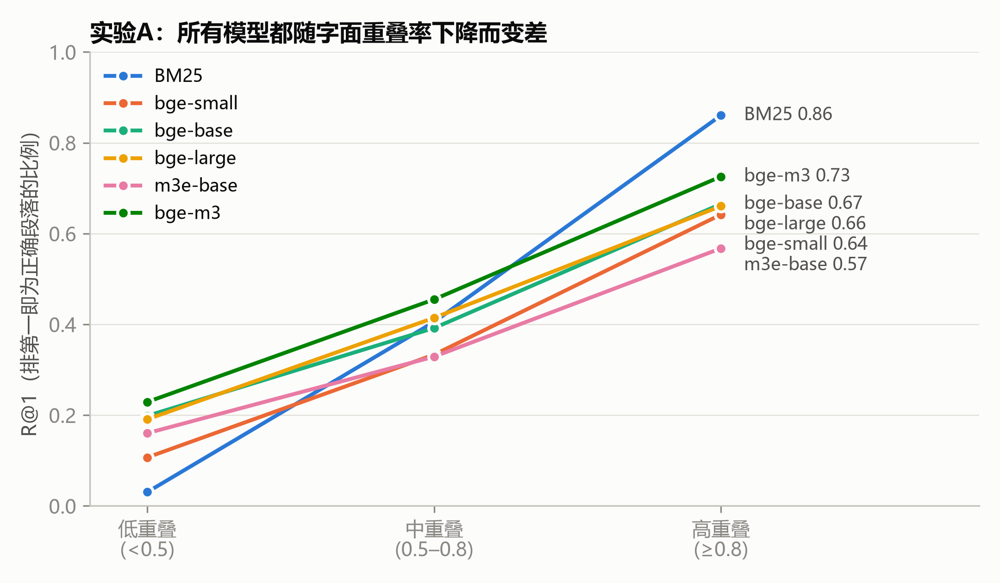

**所有方法都随重叠率下降而变差**（图 4）。BM25 最极端：高重叠组 0.860，低重叠组只有 0.031。向量模型的高低差距小一些（0.41–0.54），但仍然很大。

**模型变大，帮助有限**（图 5）。bge-large 的参数量是 bge-base 的 3 倍，整体 R@1 只高 0.005（0.456 vs 0.451），低重叠组反而略低（0.191 vs 0.198）。参数量最大的 bge-m3 在低重叠组也只有 0.229。

**整体成绩上 BM25 胜过除 bge-m3 外的所有向量模型**。原因是一半测试题是 plain 题，和段落用词几乎一样，对关键词匹配最有利。只看 paraphrase 题，所有向量模型都超过了 BM25。如果只用常规方式出题来评估，就会得出"BM25 比向量模型好"的误导性结论。

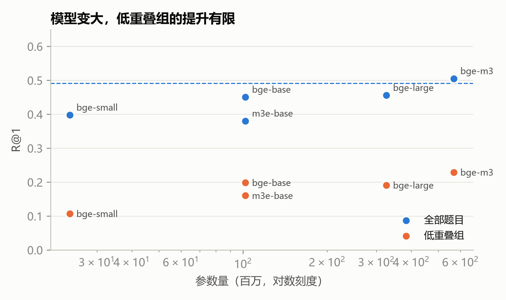

### 5.2 实验B：对比学习微调

| 方法 | 全部 | paraphrase | 低重叠 | 中重叠 | 高重叠 |
|---|---|---|---|---|---|
| bge-base（微调前） | 0.451 | 0.246 | 0.198 | 0.392 | 0.665 |
| bge-m3（不微调） | 0.505 | 0.305 | 0.229 | 0.455 | 0.726 |
| 微调·普通版 | 0.540 ± 0.010 | **0.380 ± 0.014** | 0.303 ± 0.022 | 0.497 ± 0.008 | 0.730 ± 0.010 |
| 微调·难负样本版 | **0.547 ± 0.007** | **0.380 ± 0.010** | **0.310 ± 0.010** | **0.502 ± 0.006** | **0.738 ± 0.010** |

微调结果为 3 个随机种子的均值 ± 标准差（R@1）。

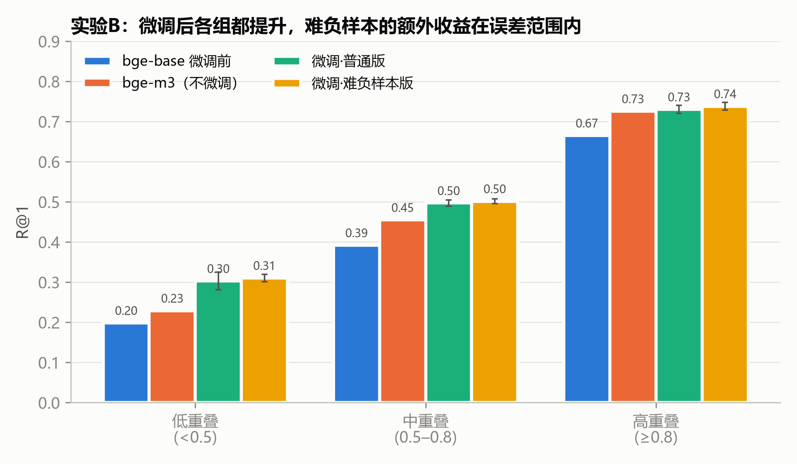

**微调有效**。只用 724 道训练题，bge-base 的整体 R@1 从 0.451 升到约 0.54，低重叠组从 0.198 升到约 0.31，两项都超过了参数量为它 6 倍的 bge-m3。低重叠组的 R@10 从 0.489 升到 0.728，说明正确段落被"捞进"前 10 名的情况明显增多。注意训练集和测试集来自不同章节，这个提升不是靠记住测试章节的内容。

**难负样本没有带来可靠的额外提升**。难负样本版在各组上比普通版高 0–0.013，都在种子间标准差（0.01–0.02）以内。可能的原因有两个：

1. 训练段落只有 184 个，每批 16 道题里本来就常出现同一章、用词相近的段落，普通版已经"顺带"见过不少难负样本。
2. BM25 选出的难负样本里可能有一部分其实也能回答问题（错误分析中发现了这类情况，见 6.2 节），把它们当错误答案训练会带来噪声。

**过拟合出现得很早**（图 6）。普通版的训练损失从约 0.64 一直降到约 0.07，但验证集 MRR 在第 1–2 轮就达到最高，之后持平或下降。6 次训练里有 5 次选中的是第 1 轮或第 2 轮。训练数据量小时，按验证集选择轮数是必要的。

**微调没有消除字面偏差**。高低重叠组的差距从 0.47 降到 0.43，只缩小了一点。微调主要是把整体成绩抬高了。

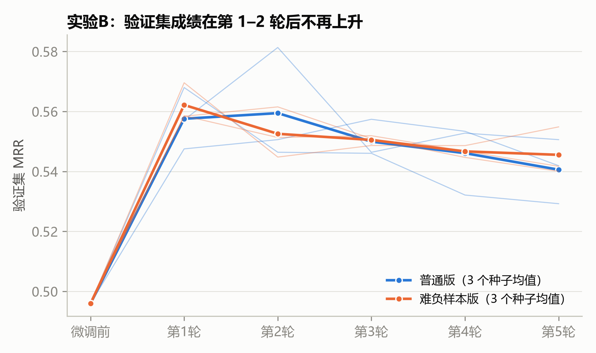

### 5.3 实验C：加 reranker

| 第一阶段 | 全部 | 低重叠 | 中重叠 | 高重叠 | 高低差距 |
|---|---|---|---|---|---|
| BM25 | 0.491 → 0.611 | 0.031 → 0.153 | 0.405 → 0.586 | 0.860 → 0.916 | 0.83 → 0.76 |
| bge-base 原版 | 0.451 → 0.657 | 0.198 → 0.290 | 0.392 → 0.626 | 0.665 → 0.912 | 0.47 → 0.62 |
| bge-base 微调后 | 0.549 → **0.671** | 0.321 → **0.336** | 0.500 → **0.631** | 0.740 → **0.916** | 0.42 → 0.58 |

表中为 R@1，箭头左边是重排前、右边是重排后。微调模型用的是难负样本版 seed 0，所以重排前的数字和 5.2 节的 3 种子均值略有不同。

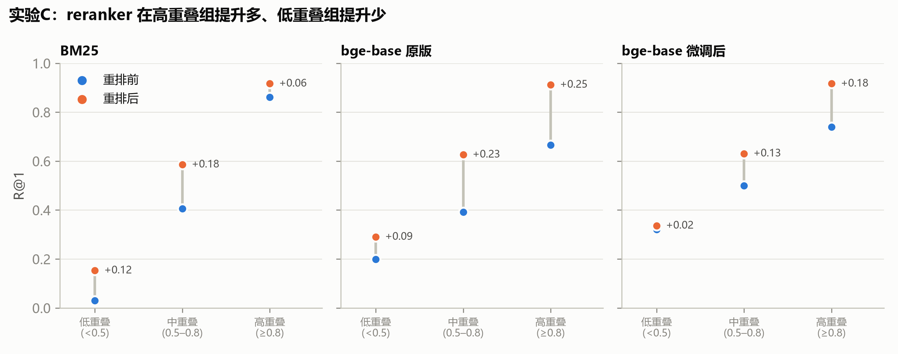

**reranker 让所有组合都变好了**，"微调后 + reranker"的整体 R@1 达到 0.671，是本文最好的结果。

**但 reranker 本身也有字面偏差**（图 8）。以微调后的模型为例，reranker 让高重叠组提升了 0.18，低重叠组只提升了 0.02，高低差距从 0.42 扩大到 0.58。下表统计了 reranker 把多少题"救回"（原来不是第一、重排后是第一）和"带坏"（原来是第一、重排后不是）：

| 微调后 + reranker | 题数 | 救回 | 带坏 | 正确段落不在前 20 名 |
|---|---|---|---|---|
| 低重叠 | 131 | 17 | 15 | 19 |
| 中重叠 | 223 | 49 | 20 | 12 |
| 高重叠 | 214 | 42 | 4 | 0 |

在低重叠组，reranker 救回 17 道、带坏 15 道，几乎抵消；在高重叠组则是救回 42 道、只带坏 4 道。

**第一阶段决定了上限**。BM25 在低重叠组的 131 道题里，有 100 道的正确段落根本没进前 20 名，reranker 无从下手；换成微调后的向量模型，这个数降到 19。所以两者的分工很清楚：微调负责把正确段落召回到候选里，reranker 负责在候选里排准。

### 5.4 主要结果汇总

图 9 把关键方法放在更细的重叠率区间上比较。从 0.9–1.0 到 0.0–0.3，所有方法的 R@1 都大幅下降。最好的组合在最低的区间（0.0–0.3）里明显不如单独的微调模型（0.21 vs 0.37），这也说明 reranker 在字面不像的题上会帮倒忙。不过这个区间只有 19 道题，差距需要谨慎解读。

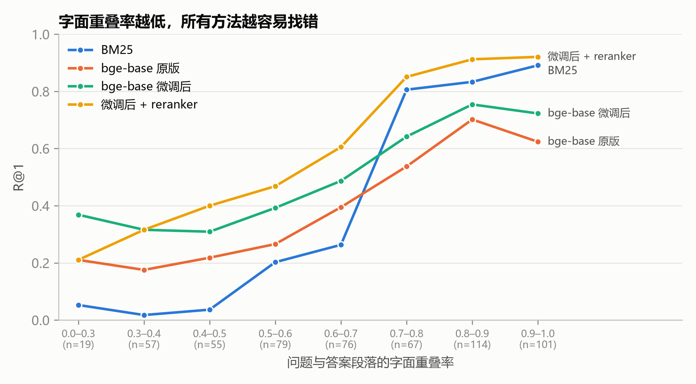

## 6 错误分析

### 6.1 方法

对最好的系统（微调 bge-base + reranker）在测试集上排错的题（即正确段落没有排第一）逐题分析（`step8_error_analysis.py`）。每道错题用两种标准判断它是不是"被字面骗了"：

- **自动标准**：分别计算问题和"系统排第一的错误段落"、问题和"正确段落"的字面重叠率。如果错误段落的重叠率更高，说明系统选中的段落在字面上比正确答案更像问题。
- **大模型标准**：把问题、正确段落、错误段落交给 DeepSeek，让它从四类原因中选一个：
  - A：错误段落其实也能回答（标注只认一个答案，算不上真错）
  - B：被字面骗，错误段落和问题有很多相同的词，但并不能回答问题
  - C：题目本身有问题（太含糊、多个段落都沾边，或答案不在正确段落里）
  - D：其他，主题相近、需要更深的理解才能区分

两种标准都有缺陷。自动标准只数字，不管意思；大模型标准会受提示词影响。本文把**两种标准都认定为"被字面骗"的题**作为主要数字，把大模型单独认定的数字作为上限。

### 6.2 结果

测试集 568 道题中，系统排错 187 道，其中 31 道的正确段落没有进入第一阶段的前 20 名，reranker 没有机会纠正。

| 重叠组 | 错题数 | 正确段落不在前 20 | 两种标准都认定被字面骗 | 大模型认定被字面骗（B） | 其实也能回答（A） | 其他（D） |
|---|---|---|---|---|---|---|
| 低重叠 | 87 | 19 | **53（61%）** | 80 | 3 | 4 |
| 中重叠 | 82 | 12 | 32（39%） | 75 | 6 | 1 |
| 高重叠 | 18 | 0 | 2（11%） | 12 | 6 | 0 |
| 合计 | 187 | 31 | **87（47%）** | 167（89%） | 15 | 5 |

没有题被判为 C 类。

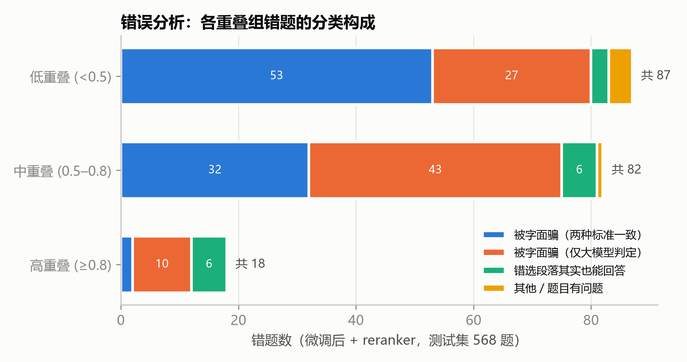

**错误集中在低重叠组，而且主要是被字面误导**（图 10）。187 道错题里有 87 道低重叠题，而低重叠题在测试集中只占 131 道，即低重叠题有 66% 排错；高重叠组 214 道题只错了 18 道。在低重叠组的错题中，61% 被两种标准一致认定为"被字面骗"：系统选中的段落和问题共用的字比正确段落还多。

**大模型标准偏向选 B**。大模型判为 B 的 167 道题中，有 80 道的错误段落字面重叠率并不高于正确段落。例如 B 类错题里，问题和正确段落的平均重叠率是 0.51，和错误段落是 0.54，差别不大。所以 167（89%）只能看作上限，本文以 87（47%）为准。

**高重叠组的错误有三分之一不算真错**。高重叠组 18 道错题中有 6 道被判为 A 类，即系统选的段落也能回答问题。这类题在全部错题中有 15 道，说明"每道题只有一个正确段落"的标注方式有噪声：教材在正文和小结里常常重复同一个结论。

### 6.3 典型例子

**被字面骗（B 类，两种标准一致）**：

| 问题 | 正确段落 | 系统选的段落 | 重叠率（正确 / 错误） |
|---|---|---|---|
| 在学这个检测方法之前，需要先掌握哪几方面的知识？ | 单发多框检测（SSD） | 目标检测和边界框 | 0.38 / 0.81 |
| 如果我已经在一个大型图片集合上训练过模型，怎样把这个模型的本领用到另一个不同的图片集合上？ | 微调（讲做法的段落） | 微调（讲数据规模与过拟合的段落） | 0.55 / 0.84 |
| 在深度学习流行之前，人们一般怎么让计算机从图片里找出有用的信息？ | AlexNet > 学习表征 | 计算机视觉（章首语） | 0.57 / 0.60 |

第一个例子最典型：问题里的"检测"让系统选中了介绍目标检测的段落，而问题真正问的是 SSD 这一节开头列出的预备知识。

**其实也能回答（A 类）**：问题"交并比（IoU）是如何定义的？"标注的正确段落是"锚框 > 小结"，系统选的是"锚框 > 交并比（IoU）"这一小节的正文，后者同样给出了定义，甚至更详细。

**其他（D 类）**：问题"怎样让电脑在图片被随机改动后仍然认得出东西，而不只是死记原来的样子？"的答案是"图像增广"，系统选了"从全连接层到卷积 > 不变性"。两段都在讲"变了也能认出来"，区分它们需要理解"随机改动训练图片"和"网络结构自带的平移不变性"是两回事，和字面关系不大。

### 6.4 小结

最好的系统剩下的错误，近一半可以确定是字面误导造成的，在低重叠组超过六成。另有 31 道题的正确段落连前 20 名都没进，这是第一阶段向量模型的问题，需要更强的召回才能解决。

## 7 外部验证：真人搜索提问

前面的实验都用大模型生成的题。为了检验结论在真人提问上是否成立，本文在 C-MTEB 的 DuRetrieval 数据集上重复了主要实验（`step9_external_validation.py`）。DuRetrieval 来自百度搜索的真实用户问题，本文使用其中 2000 道题，以全部 100,001 个段落为候选（是教材知识库的 266 倍）。一道题可能有多个正确段落，任意一个排进前 k 名就算命中；一道题的重叠率取它和各正确段落重叠率的最大值。

| 方法 | 全部（2000） | 低重叠（106） | 中重叠（412） | 高重叠（1482） |
|---|---|---|---|---|
| BM25 | 0.622 | 0.066 | 0.437 | 0.713 |
| BM25 + reranker | 0.823 | 0.160 | 0.714 | 0.900 |
| bge-base 原版 | 0.867 | 0.321 | 0.791 | 0.926 |
| bge-base 原版 + reranker | 0.902 | **0.434** | 0.845 | 0.951 |
| bge-base 微调后 | 0.855 | 0.292 | 0.786 | 0.914 |
| bge-base 微调后 + reranker | **0.903** | 0.406 | **0.857** | **0.951** |

表中为 R@1。

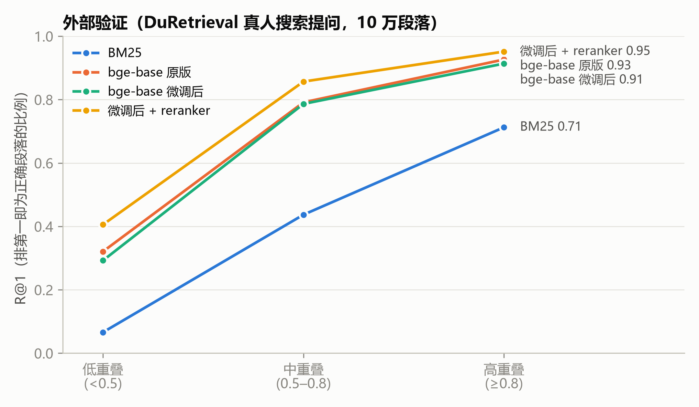

**字面重叠偏差在真人提问上同样存在**（图 11）。所有方法在低重叠组都远差于高重叠组：BM25 从 0.713 降到 0.066，最好的组合也从 0.951 降到 0.406–0.434。

**在教材上微调的模型换到搜索领域几乎没有变差**。微调后的 bge-base 整体 R@1 从 0.867 降到 0.855，只低 0.012，说明在 724 道教材题上的微调没有破坏模型原有的通用能力。但微调也没有让它在搜索领域变好，因为它学到的主要是教材领域的知识。

**reranker 在这里帮了低重叠组**。和教材测试集不同，reranker 让 bge-base 原版在低重叠组的 R@1 提高了 0.11（0.321 → 0.434）。可能的原因是 bge-reranker-base 的训练数据中包含大量搜索类问答，DuRetrieval 正好是它熟悉的领域；而教材中的 paraphrase 题是它没见过的提问方式。这说明 reranker 的字面偏差有多大，和它是否熟悉这个领域有关。

**真人搜索提问大多是高重叠的**：2000 道题中 1482 道（74%）重叠率在 0.8 以上，低于 0.5 的只有 106 道（5.3%）。所以在这类数据集上的整体成绩主要反映高重叠题，看不出模型在换说法提问上的问题。这也是本文自己构造 paraphrase 题的原因。

## 8 应用展示

本文用 Gradio 做了一个网页问答 demo（`app.py`）。用户输入问题后，可以选择三种检索方式：BM25、微调后的 bge-base、微调后的 bge-base + reranker。页面显示检索到的前 5 个段落和得分，并把这 5 个段落交给 DeepSeek，让它只根据段落回答并标注出处。

【待补：demo 截图】

下面是测试集中的一道低重叠题（重叠率 0.40）在 demo 中的实际结果：

> 问题：有一种网络能直接对图片里每一个小点判断它属于什么类别，它是靠什么办法把缩小后的特征图重新放大到和原图一样大的？

| 检索方式 | 排第一的段落 | 正确段落的名次 |
|---|---|---|
| BM25 | 暂退法（Dropout） > 扰动的稳健性 | 79 |
| bge-base 原版 | — | 15 |
| bge-base 微调后 | 全卷积网络 | 1 |
| 微调后 + reranker | 全卷积网络 | 1 |

BM25 检索到的前 5 段全部和问题无关（暂退法、分类、信息论等），因为问题里没有"全卷积""转置卷积"这类关键词。大模型拿到这些段落后回答"段落里没有答案"。换成微调后 + reranker，前 3 段都来自"全卷积网络"一节，大模型的回答是：

> 根据段落，这种网络是全卷积网络，它通过引入**转置卷积**把中间层特征图的高和宽变换回输入图像的尺寸 [1]。并且全卷积网络可以用**双线性插值的上采样**来初始化转置卷积层 [2][3]。

这个例子说明，检索选对段落是回答正确的前提。大模型被要求只根据段落回答，检索找错时它会说"没有答案"，而不是编造，这也让检索的好坏在最终回答里直接可见。

## 9 结论

### 9.1 主要结论

1. **字面重叠偏差普遍存在**。BM25、5 个向量模型、微调模型和 reranker，在字面重叠率低的题上都明显变差。最好的系统在高重叠组 R@1 为 0.916，在低重叠组只有 0.336。真人搜索数据上也有同样的现象。
2. **常规评估会掩盖这个问题**。常规方式出的题只有 0.3% 是低重叠的，真人搜索提问也只有 5.3%。只用这类题评估，会得出"BM25 比多数向量模型好"的结论。
3. **加大模型帮助有限，针对性微调更有效**。参数量增加 24 倍（bge-small → bge-m3），低重叠组 R@1 只升 0.12；用 724 道题微调 bge-base，低重叠组 R@1 升 0.11，并超过 bge-m3，换到其他领域也几乎不掉。
4. **reranker 提升整体成绩，但在不熟悉的提问方式上会放大字面偏差**。在教材上，它在高重叠组提升 0.18，在低重叠组只提升 0.02；在它熟悉的搜索领域，低重叠组则提升了 0.11。
5. **剩下的错误近一半是被字面误导**（187 道中 87 道，低重叠组 61%），另有 31 道是正确段落没有被召回。

### 9.2 局限

- **测试题由大模型生成**。paraphrase 题是大模型模仿"不懂术语的人"写的，不一定和真实学生的提问方式一致。第 3.5 节的人工抽查和手写题只是部分弥补。
- **每道题只有一个正确段落**。错误分析中有 15 道题系统选的段落其实也能回答，R@1 会因此略微低估。
- **重叠率只按汉字计算**。它没有考虑英文术语（如 ResNet、IoU）和同义词，是对"字面相似"的粗略度量。
- **规模小**。知识库 376 段、测试题 568 道，低重叠组 131 道。一些细分区间（如重叠率 0–0.3 只有 19 道题）的结论需要谨慎看待。
- **难负样本只试了一种选法**（BM25 前 10 名随机选），没有试用向量模型选或过滤掉"其实也能回答"的段落。

### 9.3 后续工作

- 用真实学生的提问（例如课程答疑记录）构建测试集。
- 生成更多 paraphrase 训练题，或者让大模型把 plain 题改写成低重叠的说法，专门训练模型处理换说法的提问。
- 改进难负样本：用大模型过滤掉"其实也能回答"的段落，减少训练噪声。
- 在第一阶段同时用 BM25 和向量模型召回（混合检索），减少正确段落没进前 20 名的情况。
- 扩展到更多课程，做成学校的课程问答助手。

## 10 复现说明

代码和数据：https://github.com/aiyujing/lexical-overlap-rag

- 环境：Windows 11，Python 3.11.3，RTX 4060 Laptop（8 GB），torch 2.14.1（CUDA 13.0），sentence-transformers 6.1.0，transformers 5.20.1，其余见 `requirements.txt`。
- 运行顺序：`step1` 到 `step10` 按编号依次运行，`make_figures.py` 生成配图，`app.py` 启动 demo。每一步的作用和耗时见 README。
- 生成好的段落和题目已经放在 `data/processed/`，可以跳过第 1–3 步（需要 DeepSeek API）直接做实验。
- 微调实验用 3 个随机种子（0、1、2），结果为均值 ± 标准差。在 RTX 4060 Laptop 上，第 4–8 步合计约 25 分钟；第 9 步主要耗时在 10 万段落的 BM25，约 12 分钟。

## 参考文献

1. Lewis P, Perez E, Piktus A, et al. Retrieval-augmented generation for knowledge-intensive NLP tasks. NeurIPS, 2020.
2. Robertson S, Zaragoza H. The probabilistic relevance framework: BM25 and beyond. Foundations and Trends in Information Retrieval, 2009.
3. Karpukhin V, Oguz B, Min S, et al. Dense passage retrieval for open-domain question answering. EMNLP, 2020.
4. van den Oord A, Li Y, Vinyals O. Representation learning with contrastive predictive coding. arXiv:1807.03748, 2018.
5. Reimers N, Gurevych I. Sentence-BERT: Sentence embeddings using Siamese BERT-networks. EMNLP, 2019.
6. Xiao S, Liu Z, Zhang P, Muennighoff N. C-Pack: Packaged resources to advance general Chinese embedding. arXiv:2309.07597, 2023.（bge-zh-v1.5、bge-reranker、C-MTEB）
7. Chen J, Xiao S, Zhang P, et al. BGE M3-Embedding: Multi-lingual, multi-functionality, multi-granularity text embeddings through self-knowledge distillation. arXiv:2402.03216, 2024.
8. Qiu Y, Li H, Qu Y, et al. DuReader-retrieval: A large-scale Chinese benchmark for passage retrieval from web search engine. EMNLP, 2022.
9. Thakur N, Reimers N, Rücklé A, et al. BEIR: A heterogeneous benchmark for zero-shot evaluation of information retrieval models. NeurIPS Datasets and Benchmarks, 2021.
10. Zhang A, Lipton Z C, Li M, Smola A J. 动手学深度学习. 人民邮电出版社, 2023. https://github.com/d2l-ai/d2l-zh
11. Wang Y, Sun Q, He S. M3E: Moka massive mixed embedding model. https://github.com/wangyuxinwhy/uniem, 2023.
