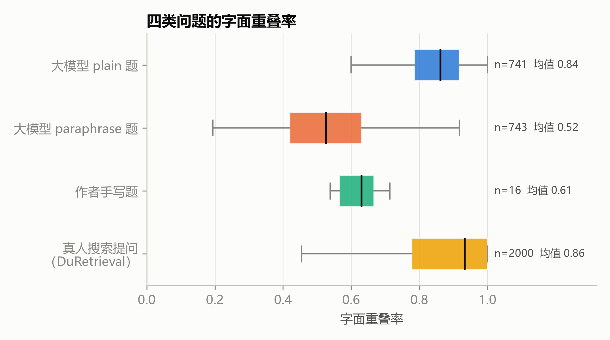
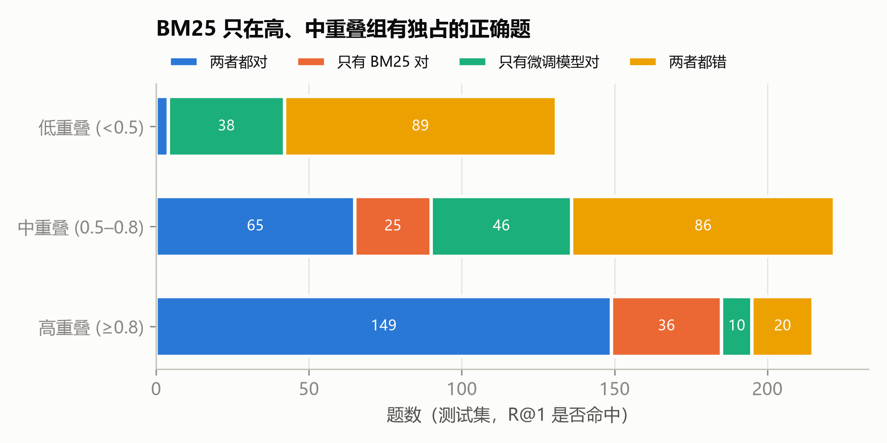
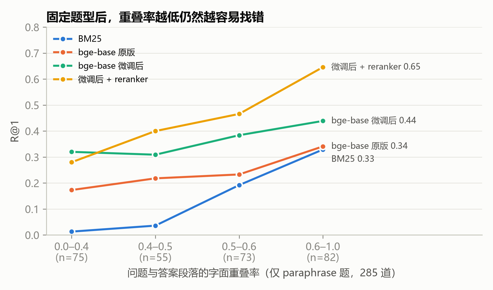
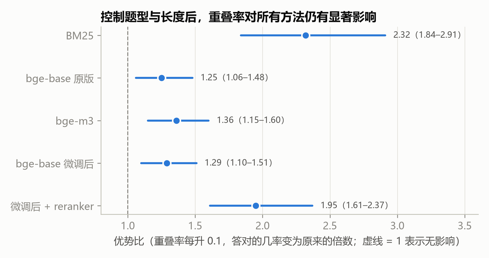
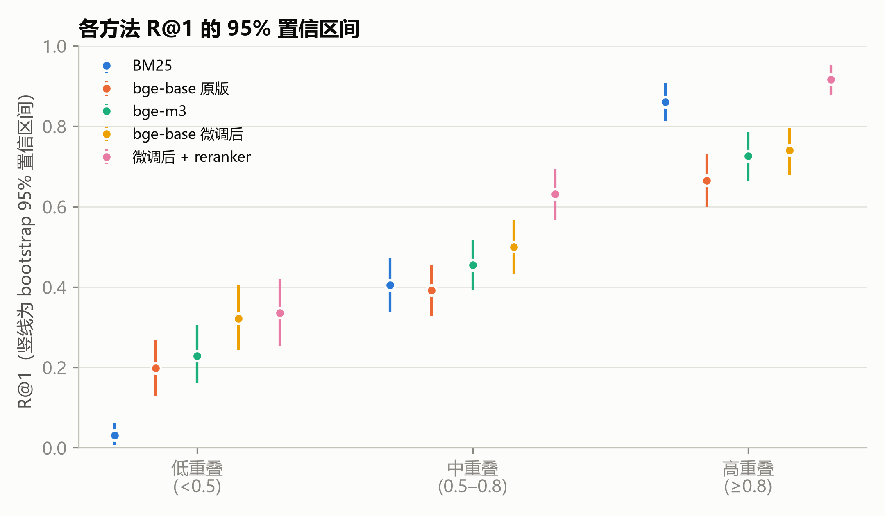
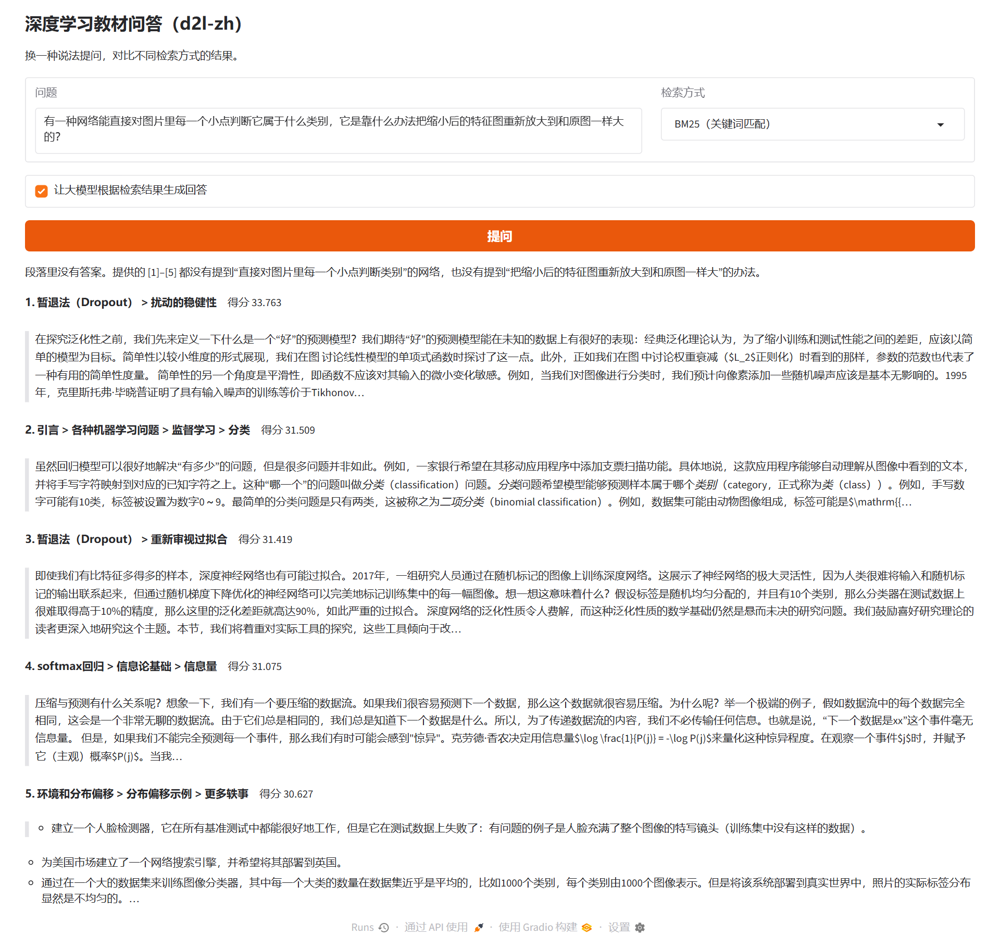
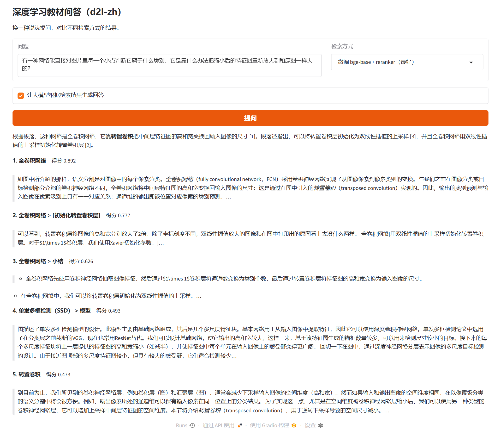

# 字面重叠偏差：中文教材问答中检索模型的分析与改进

## 摘要

检索增强生成（RAG）系统先从知识库中找出与问题相关的段落，再让大模型依据这些段落作答。检索阶段一旦选错段落，后续回答就失去了依据。本文研究中文教材问答场景下检索模型的一种系统性偏差：模型判断"问题与段落是否相关"时，在很大程度上依赖二者是否使用了相同的字。本文把这种现象称为字面重叠偏差，并用"问题中的汉字有多大比例出现在答案段落里"来度量它。

实验以《动手学深度学习》中文版的 6 章（376 个段落）为知识库，用大模型为每个段落生成两类问题：一类按常规方式出题（plain），另一类要求避开原文用词（paraphrase），共 1484 道，按章节划分训练集、验证集和测试集。在此基础上依次评估 BM25、5 个现成的中文向量模型、对比学习微调（含难负样本）和重排模型（reranker），每个实验都按重叠率分组报告，并用 bootstrap 置信区间、McNemar 配对检验和逻辑回归检验结论的可靠性。主要结果如下：

1. 所有方法在低重叠题上都明显变差。BM25 在高重叠组的 R@1 为 0.860，在低重叠组只有 0.031；5 个向量模型的参数量从 2400 万增加到 5.7 亿，低重叠组 R@1 只从 0.107 升到 0.229。由于低重叠题几乎都是 paraphrase 题，本文用逻辑回归控制题型、问题长度和段落长度，重叠率的影响仍然显著（检验的 5 种方法均为 p < 0.01）。
2. 只用 724 道训练题对 bge-base 做对比学习微调，低重叠组 R@1 从 0.198 升到 0.310（3 个随机种子均值），整体和低重叠组都优于未微调的 bge-m3（配对检验 p ≈ 0.03）；用 BM25 挑选的难负样本没有带来显著的额外提升。
3. reranker 把整体 R@1 提高到 0.671，但提升几乎全部来自中、高重叠组。在微调模型之上，高重叠组提升 0.176，低重叠组只提升 0.015（p = 0.86），高低组之间的差距扩大了 0.16（95% 置信区间 0.06–0.26）。
4. 最好系统在测试集上答错 187 道题。其中 52% 的错题里，系统选中的段落与问题的字面重叠高于正确段落；作为对照，随机抽一个其他段落，这一比例只有 23%。在低重叠组，两个比例分别是 67% 和 43%。
5. 在百度真实搜索数据 DuRetrieval（2000 道题、10 万段落）上，同样的偏差也存在；在教材上微调的模型换到该领域后，整体 R@1 从 0.867 变为 0.855，两者的置信区间重叠，未见明显退化。

关键词：检索增强生成；稠密检索；字面重叠；对比学习；重排序；错误分析

## 1 引言

### 1.1 一个例子

用向量模型 bge-small-zh-v1.5 为问题"高数挂科怎么办"检索答案时，干扰句"高数课本第三章……"的余弦相似度为 0.550，排在真正的答案"微积分不及格……可以参加补考"（0.519）前面。干扰句和问题共用了"高数"二字，而答案句用的是同义的"微积分"和"不及格"。如果把问题中的"高数"换成"线代"，干扰句的相似度降到 0.317；如果在答案句里加上"高数"，答案的相似度升到 0.673。

这个小实验说明，向量模型给出的"相似"有相当一部分来自字面上的相同，而不完全是语义上的相近。本文把这种现象称为字面重叠偏差（lexical overlap bias），并在一个完整的检索任务上对它做定量分析。

### 1.2 问题背景

检索增强生成[1]已经成为构建领域问答系统的常用方案。它把知识库切成段落，先用检索模型找出与问题最相关的几个段落，再交给大模型生成回答。和直接让大模型凭记忆回答相比，这种做法能让回答有据可查，也便于更新知识。代价是整个系统的上限取决于检索：如果正确段落没有被找出来，大模型要么回答"不知道"，要么在错误的材料上作答。

课程问答助手是 RAG 的一个典型应用。它的使用者多数是正在学习这门课的学生，而学生最需要帮助的时候，往往恰恰是还不熟悉术语的时候。他们会用自己的话描述问题，例如把"全连接层"说成"每个输入都和每个输出连在一起的那种层"，把"批量规范化"说成"让每层数据分布更稳定的处理"。如果检索模型主要依靠字面匹配，这类提问就会系统性地找错段落。

这个问题在常规评测中不容易暴露。构建检索评测集时，常见做法是让人或大模型对着段落出题。出题人看着原文，很自然会沿用原文的术语和句式，题目和答案段落的字面重叠因此偏高。本文第 3 章的统计显示，按常规方式由大模型出的题，只有 0.3% 的重叠率低于 0.5。在这样的评测集上，检索模型即使严重依赖字面匹配，也能拿到不错的分数。

### 1.3 相关工作

**稀疏检索与稠密检索。** BM25[2]是经典的稀疏检索方法，按词频、逆文档频率和文档长度给段落打分，只能匹配字面上相同的词。稠密检索用神经网络把问题和段落分别编码成向量，以向量相似度作为相关程度。DPR[3]用问答对和批内负样本训练双塔编码器，在开放域问答上超过了 BM25；Sentence-BERT[5]让 BERT 类模型可以高效地产生句向量。中文方面，BGE 系列[6]在大规模中文语料上做对比学习预训练和指令微调，是目前常用的中文向量模型；BGE-M3[7]进一步支持多语言和长文本。

**稠密检索的泛化问题。** BEIR[9]在 18 个数据集上比较了多种检索模型，发现在训练领域之外，许多稠密检索模型不如 BM25。这说明稠密模型学到的"相关性"和训练数据的分布关系很大。本文关注的是另一个方向的问题：在领域内，稠密模型也可能过度依赖字面线索，而且常规评测集掩盖了这一点。

**对比学习与难负样本。** InfoNCE 损失[4]把正确样本和一组负样本放在一起做多分类，是训练稠密检索模型的标准目标。负样本的选取对效果影响很大：DPR[3]发现加入 BM25 检索出的难负样本能提升效果；RocketQA[12]则指出，检索出的难负样本中混有"其实也正确"的段落（假负样本），直接拿来训练会引入噪声，需要另行过滤。本文第 5.2 节的结果与后一种观察一致。

**重排序。** 交叉编码器（cross-encoder）把问题和段落拼接后一起输入模型，让两边的每个词都能互相注意。Nogueira 和 Cho[13]最早把 BERT 交叉编码器用于段落重排，大幅超过了此前的方法。交叉编码器比双塔模型更精确，但每个候选段落都要单独计算一次，无法预先建索引，所以通常只用于对第一阶段召回的少量候选重新排序。本文使用 BGE 系列的 bge-reranker-base[6]。

### 1.4 本文的工作

本文的工作按数据、方法、分析三个层面组织：

- **数据层面**：基于 d2l-zh 教材构建一个中文检索数据集，每道题标注了与答案段落的字面重叠率；除常规题外，专门生成一类避开原文用词的题目；把它的重叠率分布与真人搜索提问和作者手写的提问作对比；通过人工抽查评估题目质量。
- **方法层面**：在同一测试集上比较 BM25、5 个现成向量模型、两种负样本设置下的对比学习微调，以及两阶段的召回加重排；对比学习的训练循环为手写实现，便于控制负样本的构造。
- **分析层面**：所有实验都按重叠率分组报告，并给出置信区间和配对检验；用逻辑回归和题型内分组排除题型带来的混杂；对最好系统的错题逐题分析，并为分析标准设置随机对照；在 10 万段落的真人搜索数据上做外部验证。

本文的贡献不在于提出新的检索模型，而在于：（1）用一个可复现的度量把"字面偏差"这一常被提及但很少量化的现象落到具体数字上；（2）表明常规的出题和评测方式会系统性地掩盖它；（3）检验了几类常用改进手段对它的实际作用，其中 reranker 会在不熟悉的提问方式上放大这一偏差。

## 2 任务定义与评价方法

### 2.1 检索任务

设知识库为段落集合 $\mathcal{D}=\{d_1,\dots,d_N\}$，本文中 $N=376$。给定问题 $q$，检索模型为每个段落计算一个相关分数 $s(q,d)$，并按分数从高到低排序。每道题有一个人工（或大模型）标注的正确段落 $d^+$，记它在排序中的名次为 $r(q)$，第一名为 1。

本文的设定有两点需要说明。第一，检索在全部 376 个段落中进行，不限定在问题所属的章节内，所以训练集章节的段落对测试题来说是干扰项。第二，每道题只认一个正确段落。教材中同一知识点常在正文和小结中重复出现，这一设定会把"选了另一个同样能回答的段落"算作错误，使 R@1 偏低。第 6 章的错误分析会估计这部分误差的大小。

### 2.2 字面重叠率

对问题 $q$ 和段落 $d$，记 $C(q)$ 为问题中出现的不同汉字组成的集合（去重，忽略标点、字母和数字），定义字面重叠率为：

$$\text{overlap}(q,d)=\frac{|\{c\in C(q): c \text{ 出现在 } d \text{ 中}\}|}{|C(q)|}$$

例如问题含 20 个不同的汉字，其中 16 个在答案段落里出现过，重叠率就是 0.8。重叠率按问题和它的正确段落计算，代表"从字面上看，这道题有多容易"。

选择按字而不是按词计算，原因有三：中文分词本身有误差，不同分词工具结果不同；同义词常常共享部分汉字（"不及格"和"挂科"不共享，"规范化"和"标准化"共享一半），字级度量对这种部分匹配更敏感；字级度量不依赖任何模型，便于复现。它的缺点是忽略了英文术语（如 ResNet、IoU）和语序。第 5.6 节用基于 jieba 分词的词级重叠率重复了分组分析，以检验结论对这一选择是否敏感。

本文按重叠率把题目分成三组：低重叠（< 0.5）、中重叠（0.5–0.8）和高重叠（≥ 0.8）。阈值 0.5 的含义是"问题里一半以上的字在答案段落中找不到"，0.8 则对应常规出题方式的典型水平（plain 题中位数为 0.86）。

### 2.3 评价指标

- **R@k**（Recall@k）：正确段落排进前 k 名的题目比例，即 $\frac{1}{|Q|}\sum_{q}\mathbb{1}[r(q)\le k]$。R@1 表示排在第一的恰好是正确段落，对应 RAG 中"最相关段落是否找对"，是本文的主要指标。R@5 和 R@10 反映正确段落是否进入了交给大模型的候选范围。
- **MRR**（Mean Reciprocal Rank，平均倒数排名）：$\frac{1}{|Q|}\sum_{q}1/r(q)$。正确段落排第 1 名得 1 分，第 2 名得 1/2 分，依此类推。验证集上用 MRR 选择微调的最佳轮数，因为它比 R@1 对小的排序变化更敏感。

### 2.4 统计方法

测试集只有 568 道题，低重叠组只有 131 道，组间和方法间的差异需要和随机波动区分开。本文使用以下方法（`step11_statistics.py`）：

- **置信区间**：对每个方法、每个重叠组，按题目有放回地重采样 10,000 次，取 R@1 的 2.5% 和 97.5% 分位数作为 95% 置信区间（bootstrap 百分位法[14]）。比例类指标（如人工抽查的通过率）使用 Wilson 区间。
- **配对检验**：比较两个方法时，它们是在同一批题上评估的，应当使用配对检验。本文对每道题记录两个方法各自是否答对（R@1），用 McNemar 精确检验[15]判断"只有 A 对"和"只有 B 对"的题数是否显著不同。这比直接比较两个比例更有检验力，也是 NLP 中比较两个系统的常用做法[16]。
- **差距变化的区间**：为了判断某个方法是否扩大或缩小了高低重叠组之间的差距，对差距的变化量（方法 B 的高低差距减方法 A 的高低差距）做配对 bootstrap，在两组内分别重采样。
- **混杂控制**：低重叠题几乎全是 paraphrase 题，而 paraphrase 题本身也更长、更口语化。为了区分"重叠率低"和"题型不同"的影响，用逻辑回归同时纳入重叠率、题型、问题长度和段落长度，并在 paraphrase 题内部单独按重叠率分组。
- **随机种子**：微调实验用 3 个随机种子各训练一次，报告均值和标准差。

本文报告的 p 值没有做多重比较校正。支撑主要结论的检验中，多数 p 值在 0.001 以下，按检验次数做 Bonferroni 校正后仍然显著；p 值在 0.001–0.05 之间的结果（例如微调模型与 bge-m3 的比较）在正文中会单独注明，应视为较弱的证据。

## 3 数据

### 3.1 知识库：d2l-zh 教材

知识库取自《动手学深度学习》中文版[10]（d2l-zh，Apache-2.0 许可）。选用这本书有三个原因：它的内容与本课程（机器学习）高度重合；全书开源，可以合法地加工和公开；中文表述规范，术语使用前后一致，便于分析"术语"与"大白话"之间的差别。课程课件 ML2–ML11 本身几乎全是英文，每页文字很少，不适合直接作为知识库，所以本文按课件的覆盖范围从教材中选出对应的 6 章：

| 章节 | 对应课件 | 段落数 | 用途 |
|---|---|---|---|
| 引言 | ML2 监督学习 | 55 | 训练集 |
| 线性神经网络 | ML3/ML4 回归与分类 | 34 | 训练集 |
| 多层感知机 | ML5 神经网络 | 95 | 训练集 |
| 卷积神经网络 | ML6 CNN | 48 | 验证集 |
| 现代卷积神经网络 | ML8/ML9 ResNet 与 DenseNet | 58 | 测试集 |
| 计算机视觉 | ML10/ML11 检测与分割 | 86 | 测试集 |
| 合计 | | 376 | |

**清洗**（`step1_chunk_d2l.py`）。教材源文件是带有 d2l 自定义标记的 Markdown。清洗步骤如下：

1. 删除代码块、图片和每节末尾的练习题；独立公式替换为"（公式略）"，行内公式保留原样。
2. 删除 `:cite:`、`:numref:`、`:eqref:` 等交叉引用标记，引用图表的地方保留"图"字，使句子仍然通顺。
3. 跳过以代码为主的小节，包括从零实现、简洁实现、Kaggle 比赛和数据集下载；跳过仓库中的英文原文文件（`*_origin.md`）。

清洗中发现过一个问题：最初用于删除交叉引用的正则表达式中，`\s*` 会匹配换行符，导致 15 个段落的下一行标题被拼进了正文。修正为只匹配空格和制表符后，所有实验都重新运行过，本文报告的均为修正后的结果。

**切分**。在每个小节内按自然段累积，汉字数达到 300 时切出一段；如果加入下一个自然段会超过 450 个汉字，就先切开再继续。小节末尾不足 60 个汉字的余下部分并入前一段，避免出现只有一两句话的碎片。每个段落保留它所在小节的标题路径，例如"锚框 > 使用非极大值抑制预测边界框"，检索时把标题拼接在正文前面。

最终得到 376 个段落。按全部字符（含英文、数字和公式符号）计，长度中位数为 341，四分位距 192–473，最短 78，最长 1340（图 1）；只计汉字，中位数为 263。超长段落来自单个很长的自然段，切分规则不会拆开自然段。用 bge-base 的分词器计算，标题加正文的 token 数中位数为 340，有 53 个段落（14%）超过模型的最大输入长度 512，评估时这些段落的末尾会被截断。微调训练时为节省显存，段落截断长度设为 384，有 155 个段落受影响。截断可能让少数答案位于段落末尾的题目变难，这一影响对所有向量模型相同，不影响方法间的比较，但会使 BM25（不截断）在这些题上略占优势。

### 3.2 生成题目

人工为 376 个段落出题的成本过高，本文用大模型 DeepSeek（API 实际返回的模型名为 deepseek-flash，温度 0.7）为每个段落各出 4 道题（`step2_gen_questions.py`），总计消耗约 19 万 token。提示词要求：

- **plain 题 2 道**：像正常出考题一样，答案必须能在段落中找到。这是构建检索评测集时最常见的做法。
- **paraphrase 题 2 道**：假设提问者是一个没读过这本书的学生，只能用自己的大白话描述想知道的东西，尽量不使用段落里的原词和术语，但答案仍须在段落中。

两类题使用同一个提示词同时生成，所以它们来自同一个段落、同一次调用，唯一的系统性区别是"是否避开原文用词"。这为后面比较两类题提供了一个较干净的对照。

一个具体例子（段落"全卷积网络"）：plain 题是"全卷积网络是通过什么操作将中间层特征图的高和宽变换回输入图像的尺寸的？"（重叠率 0.87），paraphrase 题是"有一种网络能直接对图片里每一个小点判断它属于什么类别，它是靠什么办法把缩小后的特征图重新放大到和原图一样大的？"。后者没有出现"全卷积""转置卷积""语义分割"等术语，用"每一个小点判断类别"代替了"像素级分类"，重叠率为 0.40。

两类题的长度差别明显：plain 题中位数 26 字（10%–90% 分位为 16–38 字），paraphrase 题中位数 38 字（27–53 字）。paraphrase 题更长，因为提问者需要用描述代替术语。第 5.5 节会控制问题长度的影响。

**过滤**（`step3_build_dataset.py`）。生成的 1504 道题中，删除了包含"本段""文中""上述"等指代原文的题目，这类题脱离段落就无法理解。最终保留 1484 道。358 个段落保留了全部 4 道题，16 个段落保留 3 道，2 个段落保留 2 道，没有段落被完全丢弃。

### 3.3 划分训练集、验证集和测试集

如果训练题和测试题出自同一个段落，模型可能只是记住了"这个段落长什么样"，测试成绩就会高估它对新内容的检索能力。即使不共享段落，同一章的段落在用词和主题上也高度相似。为此本文按章划分数据（图 2），训练、验证、测试三部分的段落互不重叠，章节也互不重叠：

| 划分 | 章节 | 题数 | 段落数 | plain 重叠率均值 | paraphrase 重叠率均值 | 低重叠占比 |
|---|---|---|---|---|---|---|
| 训练集 | 引言、线性神经网络、多层感知机 | 724 | 184 | 0.847 | 0.555 | 16.6% |
| 验证集 | 卷积神经网络 | 192 | 48 | 0.828 | 0.459 | 26.0% |
| 测试集 | 现代卷积神经网络、计算机视觉 | 568 | 144 | 0.841 | 0.509 | 23.1% |

三个划分中 plain 题的重叠率基本一致（0.83–0.85），paraphrase 题的重叠率在测试集上比训练集低约 0.05，测试集的低重叠题比例也更高。因此测试集比训练集略难，这会让微调效果的估计偏保守，而不是偏乐观。

测试集的 568 道题按重叠率分组后，低、中、高三组分别有 131、222、215 道。题型在三组中的分布很不均匀：低重叠组 131 道中有 130 道是 paraphrase 题，高重叠组 215 道中有 208 道是 plain 题。重叠率和题型高度相关，所以"低重叠组表现差"有可能部分来自 paraphrase 题的其他特点（更长、更口语化）。第 5.5 节专门处理这个混杂问题。

### 3.4 字面重叠率统计

下表和图 3、图 4 比较了不同来源的问题与其答案段落的重叠率。DuRetrieval 是百度搜索的真实用户提问（见第 7 章），一道题平均有约 5 个正确段落，这里取与问题重叠率最高的那个，即"最容易的那个答案"。手写题的情况见 3.5 节。

| 问题来源 | 题数 | 均值 | 中位数 | 低重叠（< 0.5）占比 |
|---|---|---|---|---|
| 大模型 plain 题 | 741 | 0.84 | 0.86 | 0.3% |
| 大模型 paraphrase 题 | 743 | 0.52 | 0.53 | 40.2% |
| 作者手写题 | 16 | 0.61 | 0.63 | 12.5% |
| 真人搜索提问（DuRetrieval） | 2000 | 0.86 | 0.93 | 5.3% |

从这组统计中可以得到三点观察。

**常规出题方式几乎只产生高重叠题。** plain 题中只有 0.3% 的重叠率低于 0.5，四分之三在 0.79 以上。出题者看着段落出题，很难不沿用原文的字词。如果只用这类题评估检索系统，评测集里几乎不存在"换了说法"的题目，系统对这类提问的表现就无从得知。

**真人搜索提问的重叠率同样很高。** DuRetrieval 的重叠率中位数达到 0.93，比 plain 题还高。这与数据集的构建方式有关：它的正确段落是标注员从搜索引擎返回的结果中挑出来的，而搜索引擎本身倾向于返回含有查询词的网页，于是"能被标为正确的段落"天然和问题共享很多字。所以这类公开数据集也很少覆盖"不知道术语怎么说"的提问。这并不说明真人提问不存在低重叠的情况，只说明这类情况在以搜索结果为来源的数据集里被筛掉了。

**paraphrase 题补上了低重叠区间。** paraphrase 题的重叠率中间 90% 落在 0.29–0.75 之间，中位数 0.53，有 40% 低于 0.5。这使得测试集的低重叠组有 131 道题，足以单独计算指标。作者手写题的重叠率介于两类大模型题之间（中位数 0.63），说明真人在不看原文时的提问，字面上确实比照着原文出的题更远，但通常会直接使用"残差网络""锚框"这类已经知道的名称，不会像 paraphrase 题那样刻意回避所有术语。可见 paraphrase 题代表的是一种偏极端、但真实存在的提问方式。

### 3.5 数据质量验证

大模型出的题可能存在两类问题：答案其实不在标注的段落里，或者题目读起来不像真人会问的。本文用人工抽查和手写测试题两种方式检查。

**人工抽查**。用固定随机种子从测试集抽取 100 道题，plain 和 paraphrase 各 50 道，由作者逐题判断两项（`step10_human_eval.py`）：只看标注的段落，能否回答这道题；这道题是否像真人会问的。判断"答案在段落里"时采用了较严的标准：段落只能回答问题的一部分，或者需要结合上下文才能回答的，都记为否。

| | 题数 | 答案在段落里 | 95% 区间 | 像真人会问 | 95% 区间 |
|---|---|---|---|---|---|
| 全部 | 100 | 75% | 66%–83% | 97% | 92%–99% |
| plain | 50 | 84% | 72%–92% | 98% | 90%–100% |
| paraphrase | 50 | 66% | 52%–78% | 96% | 87%–99% |

区间为 Wilson 95% 置信区间。

在答案是否在段落里这一项上，plain 题的通过率比 paraphrase 题高 18 个百分点，但两者的差异在 Fisher 精确检验下 p = 0.063，未达到 0.05 的显著水平，50 道题的样本不足以确认这一差距。从未通过的题目看，paraphrase 题的问题主要有两种：为了避开原词，问题被改得更宽泛，段落只覆盖了其中一部分；或者问题里混入了段落没有直接写出的说法。题目自然度方面，两类题都在 96% 以上，大模型出的题读起来像真人提问。

一个自然的担心是：如果有四分之一的题"答案不完全在段落里"，检索模型在这些题上答错是否就不能算模型的问题？为此本文比较了两类题上最好系统（微调 + reranker）的表现：标注合格的 75 道题 R@1 为 0.63，不合格的 25 道题为 0.60，二者接近；在 paraphrase 题内部，标注是否合格与检索对错之间也没有显著关联（Fisher p = 0.37），没有证据表明标注不完整的题目系统性地拉低了分数。不过抽查只有 100 道题，这一结论的检验力有限。

**手写测试题**。作者模拟复习时的提问，在不看原文的情况下用自己的话写了 17 道题，再对照教材为每题标注答案段落。其中 1 道问的是卷积神经网络的基本结构，属于验证集章节，不在测试集范围内，剔除后剩 16 道。

| 方法 | R@1 | R@5 | R@10 | MRR |
|---|---|---|---|---|
| BM25 | 0.125 | 0.750 | 0.875 | 0.360 |
| bge-base | 0.250 | 0.813 | 0.938 | 0.491 |
| bge-base 微调 | 0.188 | 0.938 | 0.938 | 0.474 |
| 微调 + reranker | 0.438 | 0.875 | 0.938 | 0.599 |

16 道题的样本很小，R@1 = 0.438 对应 7 道题答对，其 95% Wilson 区间为 0.23–0.67，各方法之间的差距都在区间之内。因此这组结果只用来定性地观察真人提问的特点，不用来比较方法优劣。

各方法的 R@1 都很低，R@5 却普遍在 0.75 以上。原因是手写题问得比大模型的题更宽泛，例如"残差网络的具体做法""怎么用锚框"，教材中通常有好几个段落都能回答，而评测只认作者标注的那一个。在这种情况下，R@1 主要反映"能否猜中标注者选的那一段"，R@5 更接近"是否找到了相关内容"。这也提示，如果要用真人提问构建测试集，应当允许一道题有多个正确段落。

有一道题值得单独说明。"差分学习率是怎么回事"中的"差分学习率"在教材里并没有出现，教材的说法是"输出层的参数使用更大的学习率"。BM25 凭"学习率"一词把答案排在第 2 名，而所有向量模型都把它排到了 150 名以后。这是一个与本文主线方向相反的例子：当提问者使用了知识库里没有的术语时，向量模型没能把它和教材的说法联系起来，字面匹配反而起了作用。可见 BM25 和向量模型的错误并不完全重合，第 5.4 节会定量分析二者的互补性。

## 4 方法

本章介绍实验中使用的四类方法。它们构成一条逐步加强的路线：BM25 只做字面匹配，作为偏差的参照；现成的向量模型代表"不做任何领域适配"的稠密检索；对比学习微调检验少量领域数据能否缓解偏差；reranker 检验更精细的交互式打分能否缓解偏差。

### 4.1 BM25

BM25[2]按问题中每个词在段落中的出现情况给段落打分：

$$s(q,d)=\sum_{w\in q}\text{IDF}(w)\cdot\frac{f(w,d)\,(k_1+1)}{f(w,d)+k_1\left(1-b+b\,\frac{|d|}{\overline{|d|}}\right)}$$

其中 $f(w,d)$ 是词 $w$ 在段落 $d$ 中的出现次数，$|d|$ 是段落长度，$\overline{|d|}$ 是平均段落长度，IDF 是逆文档频率：在越少段落中出现的词，权重越高。参数 $k_1$ 控制词频的饱和程度，$b$ 控制对长段落的惩罚。本文使用 rank_bm25 库的 BM25Okapi 实现，取默认值 $k_1=1.5$、$b=0.75$，中文用 jieba 精确模式分词。

BM25 的打分只取决于问题和段落共有哪些词，同义词、近义表达对它完全不可见。因此它在不同重叠率上的表现，可以看作"纯字面匹配"的参照线：如果一个向量模型在低重叠组的表现接近 BM25，就说明它基本没有利用语义信息。

### 4.2 向量检索

向量模型（又称双塔模型或双编码器）用同一个 Transformer 编码器分别把问题和段落编码成固定长度的向量 $\mathbf{e}_q$ 和 $\mathbf{e}_d$，两个向量都归一化为单位长度，相关分数为余弦相似度 $s(q,d)=\mathbf{e}_q^\top\mathbf{e}_d$。段落向量可以预先算好存起来，检索时只需编码问题并做一次矩阵乘法，速度很快，这是它在实际系统中被广泛使用的原因。代价是问题和段落在编码时互相看不见，模型只能把段落的全部信息压缩进一个向量。

本文比较 5 个公开的中文向量模型：

| 模型 | 参数量 | 层数 × 隐层维度 | 句向量取法 | 问题前缀 |
|---|---|---|---|---|
| bge-small-zh-v1.5 | 2400 万 | 4 × 512 | [CLS] | 有 |
| bge-base-zh-v1.5 | 1.02 亿 | 12 × 768 | [CLS] | 有 |
| bge-large-zh-v1.5 | 3.26 亿 | 24 × 1024 | [CLS] | 有 |
| m3e-base | 1.02 亿 | 12 × 768 | 平均池化 | 无 |
| bge-m3 | 5.68 亿 | 24 × 1024 | [CLS] | 无 |

bge-zh-v1.5 系列[6]按官方建议，在问题前加上指令前缀"为这个句子生成表示以用于检索相关文章："，段落不加。m3e-base[11]和 bge-m3[7]不需要前缀。bge-small、bge-base、bge-large 是同一系列、同一训练流程下的三个规模，用于观察"只增大模型"的效果；m3e-base 与 bge-base 结构相同、训练数据不同，用于观察"换训练数据"的效果；bge-m3 的参数最多，训练数据也最多，代表现成模型中较强的选择。

所有模型都用 fp16 推理，最大输入长度 512 个 token。在 RTX 4060 Laptop 上编码 376 个段落和 568 道题，最小的 bge-small 用时 0.6 秒，最大的 bge-m3 用时 3.5 秒。

### 4.3 对比学习微调

现成的向量模型在通用语料上训练，没有见过本教材的内容，也没有见过 paraphrase 式的提问。微调用本任务训练集中的"问题–正确段落"对继续训练模型，使相配的问题和段落在向量空间中更接近、不相配的更远。

**损失函数。** 本文使用 InfoNCE 损失[4]。每一步取一批 $B=16$ 道题 $q_1,\dots,q_B$ 及其正确段落 $d_1^+,\dots,d_B^+$，候选段落集合为本批所有正确段落（普通版），或者再加上每道题的一个难负样本（难负样本版），记为 $\{p_1,\dots,p_M\}$。对第 $i$ 道题，损失为：

$$\mathcal{L}_i=-\log\frac{\exp(\mathbf{e}_{q_i}^\top\mathbf{e}_{d_i^+}/\tau)}{\sum_{j=1}^{M}\exp(\mathbf{e}_{q_i}^\top\mathbf{e}_{p_j}/\tau)}$$

这相当于一个 $M$ 选 1 的分类问题：模型要从 $M$ 个候选段落中认出正确的那个。其他题的正确段落自然地充当了负样本，称为批内负样本（in-batch negatives）。温度 $\tau$ 取 0.05。余弦相似度的取值在 −1 到 1 之间，除以 0.05 后放大到 −20 到 20，softmax 才能给出足够尖锐的分布；温度越小，模型越要把正确段落和最像的错误段落拉开距离。

**两种负样本设置。**

- **普通版**：只用批内负样本，$M=B=16$。
- **难负样本版**：为每道题额外配一个"字面上很像、但不是答案"的段落，$M=2B=32$。具体做法是：用 BM25 以问题为查询，在训练集的 184 个段落中检索，取前 10 名中除正确段落以外的段落作为候选，每一步从中随机选一个。这些段落和问题共享很多词，却不能回答问题，恰好是字面偏差会选错的那类段落。这一设置的假设是：让模型在训练时反复见到"字面像但答案错"的例子，可以减轻它对字面的依赖。

**避免假负样本。** 如果同一批中有两道题出自同一个段落，那么对其中一道题来说，另一道题的正确段落其实也是它的正确段落，却被当作负样本训练，这会误导模型。为此，分批时保证同一批中没有两道题共用一个正确段落；选择难负样本时，也排除本批任何一道题的正确段落。

**训练设置。** 基础模型为 bge-base-zh-v1.5。选它而不是 bge-m3，一是 bge-m3 的参数量是它的 5.6 倍，在 8 GB 显存上训练困难；二是用较小的模型微调后和较大的现成模型比较，更能说明"领域数据"和"模型规模"各自的作用。优化器为 AdamW，学习率 $2\times10^{-5}$，权重衰减 0.01；前 10% 的步数线性预热，之后线性衰减到 0；梯度范数裁剪到 1.0；共训练 5 轮。问题的最大长度为 64 个 token，训练时段落截断到 384 个 token，评估时用 512。

每轮结束后在验证集（卷积神经网络一章，192 道题）上计算 MRR，取 MRR 最高的一轮的参数在测试集上评估，测试集只在最后使用一次。每种设置用随机种子 0、1、2 各训练一次，种子同时控制模型中 dropout 的随机性、分批顺序和难负样本的选取。

**实现。** 训练循环为手写实现（`step6_exp_b_finetune.py`），没有使用 sentence-transformers 自带的训练器，以便精确控制分批规则和难负样本的选取。为在 8 GB 显存上训练，使用了 bf16 混合精度和梯度检查点（反向传播时重新计算中间激活，而不是全部保存）。实验中发现，难负样本版的显存一度用满 8 GB，Windows 开始借用内存后，一次训练从约 3 分钟变为 130 分钟；加入梯度检查点并把最优参数的副本存到 CPU 内存后，显存峰值降到 2.6 GB。最终普通版每次训练约 1.9 分钟，难负样本版约 3.0–3.5 分钟。

### 4.4 重排模型（reranker）

reranker 是一个交叉编码器：把问题和段落拼接成一个序列，一起输入 Transformer，最后输出一个相关分数。和双塔模型相比，问题中的每个字在编码时都能通过注意力直接看到段落中的每个字，可以做更细致的比对。代价是每个"问题–段落"对都要单独计算一次，无法预先建索引，对全部段落逐一打分不现实。

因此实际系统采用两阶段结构：第一阶段用 BM25 或向量模型从全部 376 个段落中召回前 $K=20$ 个候选；第二阶段用 reranker 对这 20 个候选逐一打分，按新分数重新排序。正确段落如果没有进入前 20，reranker 无法挽回，这种题在重排后的名次保持第一阶段的名次。本文使用 bge-reranker-base[6]，它基于 XLM-RoBERTa，12 层，参数量 2.78 亿，最大输入长度 512 个 token，用 fp16 推理。对测试集 568 道题各重排 20 个候选，共 11,360 个"问题–段落"对，用时约 30 秒。

reranker 没有在本任务上微调。这样做是为了单独观察一个现成 reranker 对字面偏差的影响，也和实际中"直接拿现成 reranker 接在检索后面"的常见用法一致。

### 4.5 问答系统

完整的 RAG 问答系统（`app.py`）用 Gradio 实现网页界面，可以选择三种检索方式：BM25、微调后的 bge-base、微调后的 bge-base 加 reranker。系统取检索结果的前 5 个段落，连同问题交给 DeepSeek，提示词要求它"只用段落里的信息回答，用 [编号] 标出处；段落里没有答案就直说"，温度 0.3。这一约束让检索的好坏直接反映在回答中：检索找错时，大模型应当回答"没有答案"，而不是凭自己的知识作答。第 8 章展示了一个例子。

## 5 实验

所有实验都在测试集的 568 道题上评估，候选为全部 376 个段落。除非特别说明，表中数字均为 R@1，方括号内为 bootstrap 95% 置信区间。

### 5.1 Baseline 与实验 A：不同的现成向量模型

**实验设计。** 实验 A 回答的问题是：不做任何领域适配，换用更大或训练数据不同的向量模型，能否缓解字面偏差？BM25 作为纯字面匹配的参照。

| 方法 | 全部 | plain | paraphrase | 低重叠 | 中重叠 | 高重叠 | 高低差距 |
|---|---|---|---|---|---|---|---|
| BM25 | 0.491 | **0.830** | 0.154 | 0.031 | 0.405 | **0.860** | 0.83 |
| bge-small | 0.398 | 0.629 | 0.168 | 0.107 | 0.333 | 0.642 | 0.54 |
| bge-base | 0.451 | 0.657 | 0.246 | 0.198 | 0.392 | 0.665 | 0.47 |
| bge-large | 0.456 | 0.640 | 0.274 | 0.191 | 0.414 | 0.660 | 0.47 |
| m3e-base | 0.380 | 0.555 | 0.207 | 0.160 | 0.329 | 0.567 | 0.41 |
| bge-m3 | **0.505** | 0.707 | **0.305** | **0.229** | **0.455** | 0.726 | 0.50 |

低、中、高重叠组分别有 131、222、215 道题。各组 R@1 的置信区间见图 14，R@5、R@10 和 MRR 见 `results/exp_a.json`。

**所有方法都随重叠率下降而变差**（图 5）。BM25 的变化最剧烈：高重叠组 0.860，低重叠组 0.031，即低重叠的 131 道题中只答对 4 道。向量模型的高低差距在 0.41–0.54 之间，比 BM25 小，但仍然很大。以 bge-base 为例，高重叠组的 R@1 是低重叠组的 3.4 倍。重叠率与正确段落名次之间的 Spearman 相关系数，BM25 为 −0.77，5 个向量模型在 −0.44 到 −0.56 之间，都是明显的负相关。

**在低重叠组，向量模型显著好于 BM25。** 低重叠组中，BM25 答对而 bge-base 答错的题有 0 道，反过来有 22 道（McNemar p < 10⁻⁶）；对 bge-large 和 bge-m3，"只有 BM25 答对"的题也是 0 道，即 BM25 在低重叠组答对的 4 道题，这三个模型全都答对了；较弱的 bge-small 和 m3e-base 各有 3 道题输给 BM25，但赢回的分别有 13 道和 20 道。这说明向量模型确实利用了一些字面以外的信息，只是远远不够。

**整体成绩上，BM25 与多数向量模型持平或更好。** BM25 的整体 R@1（0.491）高于 bge-small（0.398）和 m3e-base（0.380），差异显著（McNemar p < 10⁻⁵）；与 bge-base（0.451，p = 0.079）、bge-large（0.456，p = 0.14）和 bge-m3（0.505，p = 0.56）的差异不显著。原因在于测试集一半是 plain 题：在 plain 题上，BM25 的 R@1 为 0.830，比 5 个向量模型都高，差异均显著（p < 10⁻⁴）；在 paraphrase 题上，bge-base、bge-large 和 bge-m3 显著好于 BM25（p < 0.01），bge-small（p = 0.68）和 m3e-base（p = 0.07）与 BM25 的差异不显著。

这个结果对评测方法有直接的含义：如果评测集只由常规方式出的题组成（相当于只看 plain 一列），会得出"BM25 比所有向量模型都好"的结论；而在换了说法的提问上，结论正好相反。评测集的构成方式会改变方法的排序。

**加大模型帮助有限**（图 6）。同一系列的三个 bge-zh-v1.5 模型中，从 small 到 base，参数量增加约 4 倍，低重叠组 R@1 从 0.107 升到 0.198；从 base 到 large，参数量再增加约 3 倍，整体 R@1 只高 0.005（0.456 对 0.451，McNemar p = 0.84），低重叠组反而低 0.007（0.191 对 0.198，p = 1.0），两项差异都不显著。参数量最大的 bge-m3 在低重叠组为 0.229，比 bge-base 高 0.031，置信区间大部分重叠，配对检验也不显著（p = 0.54）。把高低差距的变化作为指标，bge-base 换成 bge-m3 后差距变化 +0.03（95% 区间 −0.06 到 +0.12），即模型变大并没有缩小高低组之间的差距。

**训练数据比规模更重要。** m3e-base 与 bge-base 的结构完全相同，参数量也相同，但它在各组上都比 bge-base 低 0.04–0.10，整体 R@1 甚至低于 bge-small。两者的区别只在训练数据和训练方法。可见在同等规模下，模型学到了什么比模型有多大更能决定检索效果，也为下一节的微调实验提供了依据：如果训练数据重要，那么用本领域的少量数据继续训练可能比换更大的模型更有效。

### 5.2 实验 B：对比学习微调

**实验设计。** 实验 B 检验两个问题：用训练集的 724 道题微调 bge-base，能否提升低重叠组的表现；专门挑选的难负样本能否在此基础上进一步减轻字面偏差。对照组为未微调的 bge-base（同一起点）和 bge-m3（最强的现成模型）。

| 方法 | 全部 | plain | paraphrase | 低重叠 | 中重叠 | 高重叠 |
|---|---|---|---|---|---|---|
| bge-base（微调前） | 0.451 | 0.657 | 0.246 | 0.198 | 0.392 | 0.665 |
| bge-m3（不微调） | 0.505 | 0.707 | 0.305 | 0.229 | 0.455 | 0.726 |
| 微调·普通版 | 0.540 ± 0.010 | 0.702 ± 0.012 | **0.380 ± 0.014** | 0.303 ± 0.022 | 0.497 ± 0.008 | 0.730 ± 0.010 |
| 微调·难负样本版 | **0.547 ± 0.007** | **0.715 ± 0.015** | **0.380 ± 0.010** | **0.310 ± 0.010** | **0.502 ± 0.006** | **0.738 ± 0.010** |

微调结果为 3 个随机种子的均值 ± 标准差。

**微调显著提升了各组成绩**（图 7）。 只用 724 道训练题，bge-base 的整体 R@1 从 0.451 升到约 0.54，低重叠组从 0.198 升到约 0.31，相对提升 57%。以难负样本版 seed 0 为例做配对检验：整体上，微调后答对而微调前答错的题有 82 道，反过来只有 26 道（McNemar p < 10⁻⁷）；低重叠组中这两个数是 19 和 3（p < 0.001）。低重叠组的 R@10 从 0.489 升到 0.728，说明正确段落被召回到前 10 名的情况明显增多，这对后面接 reranker 很重要。

微调后的 bge-base 超过了参数量为它 5.6 倍的 bge-m3：整体 R@1 0.549 对 0.505（McNemar p = 0.025），低重叠组 0.321 对 0.229（p = 0.029）。这两个 p 值在 0.01–0.05 之间，属于较弱的证据，但方向是稳定的：两种设置的 6 次训练中，每一次在整体（0.533–0.555）和低重叠组（0.275–0.328）上都高于 bge-m3。

需要强调的是，训练集与测试集来自不同章节，段落不重叠。微调带来的提升不是记住了测试段落，而是学到了在这类教材文本上"问题和段落怎样才算相配"的更一般的规律，例如 paraphrase 式的描述通常对应哪类术语。

**难负样本没有带来可靠的额外提升。** 难负样本版在各组上比普通版高 0–0.013，都在种子间标准差（0.006–0.022）的范围内。按种子逐对做 McNemar 检验，3 个种子的 p 值分别为 0.76、0.11 和 0.87，没有一个显著。可能的原因有两个：

1. **普通版已经见过不少"难"的负样本。** 训练集只有 184 个段落、724 道题，每批 16 道题随机组合，同一批中经常出现同一章、主题和用词相近的段落。批内负样本中天然含有一定比例的难负样本。
2. **BM25 选出的难负样本有噪声。** 教材的正文和小结经常重复同一个结论，BM25 前 10 名中可能有段落其实也能回答问题。把这些段落当作负样本训练，等于教模型"这个能回答问题的段落是错的"。第 6 章的错误分析在测试集上发现了 15 道这类题，训练集中很可能也有类似情况。RocketQA[12]报告过同样的现象，并用交叉编码器过滤假负样本来解决。本文没有做这一步过滤。

另一个现象也值得注意：难负样本版的训练损失始终高于普通版（第 1 轮约 1.0 对 0.64，第 5 轮约 0.11 对 0.07）。这在预期之内，因为它的候选从 16 个增加到 32 个，而且新增的都是难区分的段落。但更难的训练任务并没有转化为更好的测试成绩。

**过拟合出现得很早**（图 8）。普通版的训练损失从约 0.64 一路下降到约 0.07，验证集 MRR 却在前 3 轮内就达到最高（0.56–0.58），之后持平或略降。6 次训练中，按验证集选中的最佳轮数有 3 次是第 1 轮，2 次是第 2 轮，1 次是第 3 轮。在 724 道题的小数据上，模型很快就记住了训练题，继续训练只会降低泛化能力。按验证集选择轮数在这里是必要的；如果直接取第 5 轮的模型，6 次训练的验证集 MRR 会比各自的最优值低 0.015–0.039。

**微调没有消除字面偏差。** 以难负样本版为例，高低重叠组的差距从微调前的 0.47 降到 0.43。按 seed 0 的逐题结果计算，差距变化为 −0.05，95% bootstrap 区间为 −0.13 到 +0.04，包含 0，即差距的缩小在统计上不显著。微调主要是把各组成绩一起抬高了：低重叠组提升 0.11，高重叠组也提升了 0.07。换句话说，微调让模型整体上更会检索这本教材，但它对字面的依赖程度并没有明显改变。

### 5.3 实验 C：两阶段检索与 reranker

**实验设计。** 实验 C 检验现成的 reranker 能否纠正第一阶段被字面误导的排序。第一阶段分别用 BM25、未微调的 bge-base 和微调后的 bge-base（难负样本版 seed 0）召回前 20 名，第二阶段用 bge-reranker-base 重排。

| 第一阶段 | 全部 | 低重叠 | 中重叠 | 高重叠 | 高低差距 |
|---|---|---|---|---|---|
| BM25 | 0.491 → 0.611 | 0.031 → 0.153 | 0.405 → 0.586 | 0.860 → 0.916 | 0.83 → 0.76 |
| bge-base 原版 | 0.451 → 0.657 | 0.198 → 0.290 | 0.392 → 0.626 | 0.665 → 0.912 | 0.47 → 0.62 |
| bge-base 微调后 | 0.549 → **0.671** | 0.321 → **0.336** | 0.500 → **0.631** | 0.740 → **0.916** | 0.42 → 0.58 |

箭头左边为重排前，右边为重排后。微调模型用的是难负样本版 seed 0，重排前的数字因此与 5.2 节的 3 种子均值略有不同。

**reranker 提升了所有组合的整体成绩。** 三种第一阶段接上 reranker 后，整体 R@1 分别提升 0.120、0.206 和 0.122，配对检验均高度显著（p < 10⁻⁷）。"微调后 + reranker"的整体 R@1 为 0.671 [0.632, 0.708]，R@5 为 0.859，MRR 为 0.757，是本文在教材测试集上的最好结果。

**但提升几乎都集中在中、高重叠组**（图 9）。以微调后的模型为第一阶段，reranker 让高重叠组提升 0.176，中重叠组提升 0.131，低重叠组只提升 0.015。低重叠组中，重排后才答对的题有 17 道，重排后反而答错的有 15 道，几乎相互抵消（McNemar p = 0.86）。高低组的差距从 0.42 扩大到 0.58，差距的变化量为 +0.16，95% bootstrap 区间为 [0.06, 0.26]，不包含 0。在这个设定下，reranker 显著地放大了字面偏差。

对 bge-base 原版也是同样的模式：差距变化 +0.16 [0.05, 0.25]。唯一的例外是 BM25：BM25 本身在高重叠组已经很高（0.860），能提升的空间小，而在低重叠组几乎为 0，reranker 只要救回几道就是明显提升，所以差距缩小了 0.07，但区间为 [−0.14, 0.00]，上界恰好落在 0 附近，不能认为显著。

下表按组统计了 reranker 对"微调后"系统的影响。"救回"指重排前不是第一、重排后是第一；"带坏"指重排前是第一、重排后不是。

| 重叠组 | 题数 | 救回 | 带坏 | 净变化 | 正确段落不在前 20 |
|---|---|---|---|---|---|
| 低重叠 | 131 | 17 | 15 | +2 | 19 |
| 中重叠 | 222 | 49 | 20 | +29 | 12 |
| 高重叠 | 215 | 42 | 4 | +38 | 0 |
| 合计 | 568 | 108 | 39 | +69 | 31 |

高重叠组"救回 42、带坏 4"，低重叠组"救回 17、带坏 15"，两组的差别很大。一种可能的解释是：reranker 虽然能让问题和段落的每个字互相对照，但它在训练中学到的"相关"同样带有字面特征。当问题和正确段落共享很多字时，交叉注意力能精确地找到对应关系，把正确段落提到第一；当问题换了说法，交叉编码器找不到可以对齐的字，它倾向于选择字面上和问题更像的候选，而这些候选往往是错的。第 7 章的外部验证给出了这一解释的另一面：在 reranker 熟悉的搜索领域，它在低重叠组是有帮助的。

**第一阶段的召回决定了 reranker 的上限。** BM25 在低重叠组的 131 道题中，有 100 道的正确段落根本不在前 20 名之内，reranker 无从下手；换成微调后的向量模型，这个数字降到 19。从整体看，正确段落进入前 20 名的比例，BM25 为 74.8%，bge-base 原版为 85.9%，微调后为 94.5%。微调的主要价值之一，是把正确段落送进 reranker 的候选范围。

这也解释了为什么"BM25 + reranker"的整体成绩（0.611）明显低于"微调 + reranker"（0.671），而两者在高重叠组几乎一样（都是 0.916）：差别全部来自 BM25 在中、低重叠组召回不到正确段落。

**计算代价。** 对 568 道题各重排 20 个候选，reranker 用时约 30 秒，平均每道题约 53 毫秒；相比之下，bge-base 编码全部 376 个段落和 568 道题合计只用 1.6 秒，而且段落向量可以预先计算。reranker 的耗时与候选数 $K$ 成正比，对交互式问答系统来说 $K=20$ 的延迟可以接受，但 $K$ 不宜再大。

### 5.4 BM25 与向量模型的互补性

5.1 节显示 BM25 在高重叠组很强，向量模型在低重叠组更好；3.5 节的"差分学习率"一例又显示，向量模型也有 BM25 能答对而它答错的题。二者的错误在多大程度上不重合，决定了把它们结合起来（混合检索）有多少潜在收益。表中按 R@1 是否命中，统计 BM25 与微调后 bge-base 的对错组合：

| 重叠组 | 题数 | 两者都对 | 只有 BM25 对 | 只有微调模型对 | 两者都错 | 至少一个对 |
|---|---|---|---|---|---|---|
| 低重叠 | 131 | 4 | 0 | 38 | 89 | 0.321 |
| 中重叠 | 222 | 65 | 25 | 46 | 86 | 0.613 |
| 高重叠 | 215 | 149 | 36 | 10 | 20 | 0.907 |
| 合计 | 568 | 218 | 61 | 94 | 195 | 0.657 |

两者的互补性主要在中、高重叠组（图 10）。高重叠组中有 36 道题只有 BM25 答对，只有微调模型答对的仅 10 道；低重叠组则完全相反，BM25 没有任何一道独占的正确题。"至少一个对"可以看作理想的混合策略在 R@1 上的上限：整体为 0.657，比微调模型单独使用（0.549）高 0.108，接近"微调 + reranker"的 0.671。但这个上限要求事先知道该信谁，实际的混合方法达不到。

从召回的角度看，互补性要小得多：前 20 名召回率，BM25 为 74.8%，微调模型为 94.5%，二者取并集为 95.2%，只多 0.7 个百分点。因此在两阶段系统中，把 BM25 的召回结果合并进候选，对 reranker 能看到的候选几乎没有增加。混合检索的收益主要会体现在排序上（第一名选谁），而不是召回上。

### 5.5 混杂因素：是重叠率的影响，还是题型的影响？

3.3 节指出，低重叠组 131 道题中有 130 道是 paraphrase 题。paraphrase 题除了重叠率低以外，还更长、更口语化，可能更含糊（3.5 节的抽查中它的"答案在段落里"比例也更低）。所以，前面"低重叠组表现差"的结论，原则上也可以解释为"paraphrase 题本身就更难"，与重叠率无关。本节用两种方法区分这两种解释。

**方法一：题型内部的分组。** 只看 285 道 paraphrase 题，按重叠率再细分为 4 组。如果重叠率本身没有影响，那么在同一题型内部，各组的 R@1 应当差不多。

| 方法 | 0.0–0.4（75 道） | 0.4–0.5（55 道） | 0.5–0.6（73 道） | 0.6–1.0（82 道） |
|---|---|---|---|---|
| BM25 | 0.013 | 0.036 | 0.192 | 0.329 |
| bge-base 原版 | 0.173 | 0.218 | 0.233 | 0.341 |
| bge-base 微调后 | 0.320 | 0.309 | 0.384 | 0.439 |
| 微调后 + reranker | 0.280 | 0.400 | 0.466 | 0.646 |

在 paraphrase 题内部，四种方法的 R@1 仍然随重叠率升高而上升（图 11）。BM25 从 0.013 升到 0.329，"微调后 + reranker"从 0.280 升到 0.646。微调模型的曲线最平：前两组几乎没有差别（0.320 对 0.309），最高组也只比最低组高 0.12。这与 5.2 节"微调整体抬高、偏差有所减轻但不显著"的结论一致。另外，在重叠率最低的一组中，"微调后 + reranker"（0.280）低于单独的微调模型（0.320），reranker 在这里起了反作用；到最高一组，reranker 带来了 0.21 的提升。

**方法二：逻辑回归。** 以"R@1 是否命中"为因变量，以重叠率、题型（paraphrase 为 1）、问题长度和段落长度为自变量，对每个方法拟合一个逻辑回归。下表报告各变量的优势比（odds ratio，OR）。重叠率的 OR 表示：在其他变量不变时，重叠率每升高 0.1，答对的几率（odds）变为原来的多少倍。OR = 1 表示没有影响。

| 方法 | 重叠率 OR [95% 区间] | p | 题型 OR | p | 段落每长 100 字 OR | p | 伪 R² |
|---|---|---|---|---|---|---|---|
| BM25 | 2.32 [1.84, 2.91] | < 10⁻¹² | 0.23 | < 0.001 | 0.86 | 0.048 | 0.454 |
| bge-base 原版 | 1.25 [1.06, 1.48] | 0.007 | 0.38 | 0.005 | 0.90 | 0.065 | 0.139 |
| bge-m3 | 1.36 [1.15, 1.60] | < 0.001 | 0.41 | 0.008 | 0.91 | 0.094 | 0.141 |
| bge-base 微调后 | 1.29 [1.10, 1.51] | 0.002 | 0.38 | 0.004 | 0.80 | < 0.001 | 0.124 |
| 微调后 + reranker | 1.95 [1.61, 2.37] | < 10⁻¹¹ | 0.64 | 0.24 | 0.76 | < 0.001 | 0.254 |

控制了题型、问题长度和段落长度之后，重叠率对所有方法的影响都显著，OR 的置信区间都不包含 1（图 12）。只在 paraphrase 题上拟合（去掉题型变量）时，重叠率的 OR 在 1.33（bge-base 原版，p = 0.014）到 3.67（BM25）之间，同样全部显著。因此，"重叠率越低越容易找错"不能用题型差异来解释。

回归结果还显示了几个其他的规律：

- **题型本身也有独立的影响。** 对 BM25 和三个向量模型，paraphrase 题的 OR 在 0.23–0.41 之间，即在重叠率相同的情况下，paraphrase 题仍然更难。这和 3.5 节抽查中 paraphrase 题"答案在段落里"的比例较低相符：一部分 paraphrase 题本身更含糊。但对"微调后 + reranker"，题型的影响不再显著（p = 0.24），在控制重叠率后，它在两类题上的表现没有明显差别。
- **reranker 对重叠率最敏感。** 在 4 个基于向量模型的系统中，"微调后 + reranker"的重叠率 OR 最大（1.95），比单独的微调模型（1.29）高得多，两者的置信区间不重叠。这从另一个角度印证了 5.3 节的结论：reranker 放大了字面偏差。
- **段落越长越难找对。** 段落每长 100 字，微调模型答对的几率降为 0.80 倍（p < 0.001）。这可能与两个因素有关：长段落包含多个主题，压缩成一个向量时信息被稀释；有 14% 的段落超过 512 个 token 被截断。BM25 对段落长度的敏感度较低，因为它有专门的长度归一化项。
- **伪 R² 差别很大。** 这里用的是 McFadden 伪 R²，它衡量模型相对于只含截距的模型改善了多少，不能直接理解为方差解释比例。BM25 为 0.454，说明重叠率、题型和长度这几个表面特征对它的对错有很强的预测力；向量模型只有 0.12–0.14，它们的对错更多地取决于这些特征以外的因素，即模型确实利用了一些字面以外的信息。

### 5.6 稳健性检查

**换用词级重叠率。** 字级重叠率可能高估了一些"偶然共享单字"的情况，例如"的""是"在多数段落里都会出现。本文用 jieba 对问题分词，去掉单字词，计算问题中的多字词有多大比例出现在答案段落中，作为词级重叠率。词级重叠率与字级重叠率的 Spearman 相关系数为 0.915。由于词级重叠率的分布与字级不同，这里按三分位数把测试集分成低、中、高三组（各约 190 道题）：

| 方法 | 低（≤ 0.30，197 道） | 中（186 道） | 高（> 0.71，185 道） | 高低差距 |
|---|---|---|---|---|
| BM25 | 0.071 | 0.559 | 0.870 | 0.80 |
| bge-base 原版 | 0.213 | 0.495 | 0.659 | 0.45 |
| bge-m3 | 0.264 | 0.565 | 0.703 | 0.44 |
| bge-base 微调后 | 0.335 | 0.597 | 0.730 | 0.40 |
| 微调后 + reranker | 0.365 | 0.753 | 0.914 | 0.55 |

换用词级度量后，各方法的排序和高低差距都与字级度量下的结果一致：BM25 的差距最大，微调模型的差距最小，reranker 使差距扩大。主要结论不依赖于重叠率按字还是按词计算。

**按章节。** 测试集的两章分别计算，计算机视觉一章（342 道题）上四个系统的 R@1 依次为 BM25 0.471、bge-base 0.444、微调后 0.535、微调后 + reranker 0.632；现代卷积神经网络一章（226 道题）上依次为 0.522、0.460、0.571、0.730。两章的绝对水平不同（现代卷积神经网络一章的题略容易，重叠率均值 0.687 对 0.667），但方法之间的排序相同。

### 5.7 主要结果汇总

图 13 把四个主要系统放在更细的重叠率区间上比较，图 14 给出了三个重叠组的置信区间。

从重叠率 0.9–1.0 到 0.0–0.3，所有系统的 R@1 都大幅下降。在每个系统内部，高重叠组与低重叠组的置信区间都相距很远，组间差异远大于抽样误差。在重叠率最低的区间（0.0–0.3，19 道题），"微调后 + reranker"不如单独的微调模型（0.21 对 0.37），与 5.5 节在 paraphrase 题内部看到的现象一致；不过这个区间的样本很小，单看这一点不足以下结论。

把实验 A、B、C 放在一起看，从 BM25 到最好的系统，整体 R@1 从 0.491 升到 0.671，低重叠组从 0.031 升到 0.336，高重叠组从 0.860 升到 0.916。各种改进在低重叠组带来的绝对提升（0.31）远大于高重叠组（0.06），但低重叠组的最终水平仍然只有高重叠组的三分之一多一点。

## 6 错误分析

第 5 章从统计上说明了字面重叠率与检索对错的关系。本章换一个角度，逐题检查最好的系统（微调后 bge-base + reranker）答错的题，回答两个问题：错题中有多少是"被字面相似的错误段落误导"造成的；还有哪些其他类型的错误。

### 6.1 方法

测试集 568 道题中，该系统在 187 道题上没有把正确段落排在第一。对每道错题，取系统排在第一的错误段落（以下简称"错选段落"），用两种标准判断错误原因（`step8_error_analysis.py`）。

**自动标准。** 分别计算问题与错选段落、问题与正确段落的字面重叠率。如果前者更高，说明错选段落在字面上比正确答案更像问题，记为"字面更像错选段落"。这一标准完全客观、可复现，但只数字、不管意思。

自动标准需要一个参照：即使系统完全随机地选错，错选段落的重叠率也有一定概率高于正确段落。为此，对每道错题，计算知识库中所有其他 375 个段落里重叠率高于正确段落的比例，作为"随机选一个错误段落"时的基线概率。只有当错题中"字面更像错选段落"的比例明显高于这一基线时，才能说系统倾向于被字面误导。

**大模型标准。** 把问题、正确段落和错选段落交给 DeepSeek（温度 0），让它从四类原因中选择一个最主要的，并用一句话说明理由：

- A：错选段落其实也能回答问题（标注只认一个答案，不算真正的错误）
- B：被字面误导，错选段落和问题有很多相同的词，但并不能回答问题
- C：题目本身有问题（太含糊、多个段落都沾边，或答案不在正确段落里）
- D：其他，例如主题相近、需要更深的理解才能区分

大模型标准能考虑语义，例如判断错选段落是否其实也能回答问题，但它的判断可能受提示词措辞的影响，需要检验其可靠性。

### 6.2 结果

**正确段落未被召回的错题。** 187 道错题中，有 31 道的正确段落不在第一阶段的前 20 名之内，reranker 没有机会纠正。这 31 道题中，19 道来自低重叠组，12 道来自中重叠组，高重叠组没有。这部分错误需要通过改进第一阶段的召回来解决。

**自动标准。** 下表按重叠组列出错题中"字面更像错选段落"的比例，以及随机基线：

| 重叠组 | 错题数 | 错选段落重叠率更高 | 随机基线 | 平均重叠率：正确 / 错选 / 随机 |
|---|---|---|---|---|
| 低重叠 | 87 | 58（66.7%） | 43.2% | 0.376 / 0.474 / 0.368 |
| 中重叠 | 82 | 37（45.1%） | 6.2% | 0.599 / 0.582 / 0.382 |
| 高重叠 | 18 | 3（16.7%） | 0.1% | 0.886 / 0.823 / 0.407 |
| 合计 | 187 | 98（52.4%） | 22.8% | 0.523 / 0.555 / 0.378 |

图 15 按重叠组给出了错题的分类构成。从全部错题看，错选段落与问题的平均重叠率（0.555）高于正确段落（0.523），配对 Wilcoxon 符号秩检验 p = 0.012；52.4% 的错题中错选段落重叠率更高，是随机基线（22.8%）的 2.3 倍。系统选错时，倾向于选中字面上更像问题的段落。

这一倾向在不同重叠组中的表现方式不同。低重叠组中，正确段落的重叠率（0.376）与随机段落（0.368）几乎一样，也就是说，从字面上看正确段落和知识库中任意一个段落没有区别；而系统错选的段落重叠率达到 0.474，比正确段落高 0.10。在这一组，67% 的错误可以用"选了字面更像的段落"来描述，高于基线的 43%。中、高重叠组的情况不同：正确段落本身的重叠率已经很高，错选段落的平均重叠率略低于正确段落，但仍远高于随机段落（0.582 对 0.382）。可见在这两组中，系统的错误多发生在"几个字面都很像的候选之间"，错选的段落虽然不比正确段落更像，但也是从字面相近的段落中选出来的。

**大模型标准。** DeepSeek 把 187 道错题中的 167 道（89%）判为 B 类"被字面误导"，15 道判为 A 类"其实也能回答"，5 道判为 D 类，没有判为 C 类的题。

但大模型标准与自动标准几乎没有一致性。两种标准对"是否被字面误导"的判断一致率为 51%，Cohen's kappa[17] 为 −0.01，与随机一致无异。在大模型判为 B 类的 167 道题中，有 80 道的错选段落重叠率实际上并不高于正确段落；B 类题中问题与正确段落的平均重叠率为 0.51，与错选段落为 0.54，差别很小。这说明大模型在给出"被字面误导"这个判断时，并没有真正依据字面重叠，更可能是因为提示词把 B 类描述得最贴近"检索错误"的一般印象，它倾向于选这一类。

因此，本文不采用大模型的 B 类比例作为"被字面误导"的估计，而以自动标准的结果为准。两种标准都认定为"被字面误导"的题有 87 道（47%），但由于两种标准近乎独立，这个交集并不比单一标准更可靠，本文不把它作为估计。大模型标准中 A 类的判断仍然有参考价值，因为"错选段落能否回答问题"是自动标准无法判断的，而且 A 类的结论可以通过查看段落内容直接核对，下文会具体讨论。

**"其实也能回答"的错题。** 被判为 A 类的 15 道题中，高重叠组占 6 道，占该组 18 道错题的三分之一。逐题查看这 15 道题，有 13 道的正确段落和错选段落中有一个是该节的"小结"：教材在正文中给出一个结论，又在小结中用几乎相同的话重复一遍，题目标注的是其中一处，系统选了另一处。其余 2 道的两个段落是同一节中内容相近的两个小节。所有 15 道题的正确段落和错选段落都来自同一节。这类错误反映的是标注方式的局限，而不是检索的失败。如果把这 15 道题算作正确，"微调后 + reranker"的整体 R@1 会从 0.671 升到 0.697。考虑到大模型的判断本身不完全可靠，这个数字只作为单答案标注带来的低估的粗略量级。

### 6.3 典型例子

**被字面误导（自动标准判定）：**

| 问题 | 正确段落 | 系统选的段落 | 重叠率（正确 / 错选） |
|---|---|---|---|
| 在学这个检测方法之前，需要先掌握哪几方面的知识？ | 单发多框检测（SSD） | 目标检测和边界框 | 0.38 / 0.81 |
| 如果我已经在一个大型图片集合上训练过模型，怎样把这个模型的本领用到另一个不同的图片集合上？ | 微调（讲具体做法的段落） | 微调（讲数据规模与过拟合的段落） | 0.55 / 0.84 |
| 在深度学习流行之前，人们一般怎么让计算机从图片里找出有用的信息？ | AlexNet > 学习表征 | 计算机视觉（章首语） | 0.57 / 0.60 |

第一个例子最典型：问题里的"检测"一词让系统选中了介绍目标检测基本概念的段落（重叠率 0.81），而问题实际问的是 SSD 一节开头列出的预备知识，正确段落和问题只共享 38% 的字。第二个例子中，两个段落都属于"微调"一节，系统选的段落讲的是"数据集太小时直接训练容易过拟合"，和问题中"大型图片集合""训练过模型"等字面高度相同，但并没有回答"怎样用到另一个集合上"。

**其实也能回答（A 类）：** 问题"交并比（IoU）是如何定义的？"标注的正确段落是"锚框 > 小结"，系统选的是"锚框 > 交并比（IoU）"这一小节的正文。后者同样给出了定义，而且更详细。

**其他（D 类）：** 问题"怎样让电脑在图片被随机改动后仍然认得出东西，而不只是死记原来的样子？"的答案是"图像增广"一节，系统选了"从全连接层到卷积 > 不变性"。两段都在讲"图片变了也能认出来"，区分它们需要理解"随机改动训练图片以提高泛化"和"网络结构自带的平移不变性"是两回事。这类错误和字面关系不大，属于语义层面的混淆。另一个 D 类例子"一个用来做图像逐像素分类的模型，是怎么一步步把原始图片变成每个像素所属类别的预测结果的？"，正确段落是"全卷积网络 > 小结"，系统选的是同一节的正文，两段内容高度相近，严格说也可以归入 A 类。

### 6.4 小结

最好的系统剩下的 187 道错题中，31 道是正确段落未被召回造成的；在其余错误中，系统明显倾向于选择字面上和问题更像的段落，这一倾向在低重叠组最强。另有约 15 道题是单答案标注造成的"假错误"，集中在高重叠组。

方法上，本章的一个教训是：用大模型给错误原因分类，需要有独立的标准检验它的可靠性。在本实验中，大模型对"被字面误导"的判断与客观的字面统计几乎无关，若不加检验直接采用，会把字面误导造成的错误比例高估到 89%。

## 7 外部验证：真人搜索提问

前面的实验使用的都是大模型生成的题目和一本教材。为了检验结论在真人提问和更大规模的知识库上是否成立，本文在 C-MTEB[6]收录的 DuRetrieval 数据集上重复了主要实验（`step9_external_validation.py`）。

### 7.1 数据与设置

DuRetrieval 来自 DuReader-retrieval[8]，问题是百度搜索的真实用户查询，正确段落由人工从搜索结果中标注。本文使用 C-MTEB 版本的 2000 道开发集问题，以全部 100,001 个段落为候选，规模是教材知识库的 266 倍。一道题可能有多个正确段落，任意一个排进前 k 名即算命中；一道题的重叠率取它与各正确段落重叠率中的最大值。

所用模型与教材实验完全相同，包括在教材上微调过的 bge-base（难负样本版 seed 0），没有在 DuRetrieval 上做任何训练。reranker 同样重排前 20 名。BM25 在 10 万段落上用 rank_bm25 计算，用时约 12 分钟，是整个实验中最耗时的一步。

### 7.2 结果

| 方法 | 全部（2000） | 低重叠（106） | 中重叠（412） | 高重叠（1482） |
|---|---|---|---|---|
| BM25 | 0.622 | 0.066 | 0.437 | 0.713 |
| BM25 + reranker | 0.823 | 0.160 | 0.714 | 0.900 |
| bge-base 原版 | 0.867 | 0.321 | 0.791 | 0.926 |
| bge-base 原版 + reranker | 0.902 | **0.434** | 0.845 | 0.951 |
| bge-base 微调后 | 0.855 | 0.292 | 0.786 | 0.914 |
| bge-base 微调后 + reranker | **0.903** | 0.406 | **0.857** | **0.951** |

表中为 R@1。整体 R@1 的 95% Wilson 区间宽约 ±0.02，低重叠组约 ±0.09。

**字面重叠偏差在真人提问上同样存在**（图 16）。所有方法在低重叠组都远差于高重叠组：BM25 从 0.713 降到 0.066，bge-base 原版从 0.926 降到 0.321，最好的组合也从 0.951 降到 0.40 左右。和教材测试集相比，DuRetrieval 上各方法的整体成绩高得多，但这主要是因为它 74% 的题都在高重叠组；看低重叠组，各方法的水平与教材测试集相近（教材上最好系统 0.336，这里 0.406–0.434）。

**在教材上微调的模型换到搜索领域没有明显退化。** 微调后 bge-base 的整体 R@1 为 0.855 [0.838, 0.869]，原版为 0.867 [0.851, 0.881]，相差 0.012，两者的置信区间大部分重叠。低重叠组相差 0.029（0.292 对 0.321），在 106 道题的样本上也远小于区间宽度。在 724 道教材题上的微调没有破坏模型原有的通用检索能力，这对实际应用很重要：一个为某门课微调的检索模型，遇到课程以外的问题时不会明显变差。另一方面，微调也没有让模型在搜索领域变得更好，它学到的主要是教材领域的知识，而不是一种通用的"不依赖字面"的能力。

**reranker 在搜索领域对低重叠组有帮助。** 这是和教材测试集最不同的地方。在 DuRetrieval 上，reranker 让 bge-base 原版在低重叠组的 R@1 提高了 0.113（0.321 → 0.434），让微调后的模型提高了 0.114；而在教材测试集上，对应的提升只有 0.09 和 0.015。

一个可能的解释是领域熟悉程度。据 BGE 的技术报告[6]，该系列模型的训练数据以中文网页、问答社区和搜索类数据为主，DuRetrieval 这类"搜索词–网页段落"的数据很可能是它熟悉的分布，即使问题和段落字面不同，它也见过类似的"搜索词–网页"对应关系。教材中的 paraphrase 题是它没有见过的提问方式：一个不懂术语的人用描述代替专业名词，问的又是深度学习这样的专业内容。在这种情况下，它退回到依赖字面相似。这个解释与 5.3 节的观察一致，但本文没有直接检验它，例如在教材上微调 reranker 后再比较。可以确定的是：reranker 会不会放大字面偏差，取决于具体的领域和提问方式，不能一概而论。

**真人搜索提问大多是高重叠的。** 2000 道题中，1482 道（74%）的重叠率在 0.8 以上，低于 0.5 的只有 106 道（5.3%）。在这样的数据集上，整体成绩主要反映高重叠题，模型在换说法提问上的弱点几乎不影响总分。例如 BM25 在低重叠组几乎完全失败（0.066），但由于这类题只占 5%，它的整体 R@1 仍有 0.622。这再次说明，按重叠率分组报告是必要的，只看整体分数会掩盖这类问题。

## 8 应用展示

本文用 Gradio 实现了一个网页问答 demo（`app.py`）。用户输入问题后，可以选择三种检索方式：BM25、微调后的 bge-base、微调后的 bge-base 加 reranker。页面显示检索到的前 5 个段落和各自的得分，并把这 5 个段落交给 DeepSeek，由它根据段落作答并标注出处编号。

下面用测试集中的一道低重叠题（q1216，重叠率 0.40）演示不同检索方式对最终回答的影响：

> 问题：有一种网络能直接对图片里每一个小点判断它属于什么类别，它是靠什么办法把缩小后的特征图重新放大到和原图一样大的？

这道题的正确段落是"全卷积网络"一节的第一段，答案是"转置卷积"。问题中没有出现"全卷积""转置卷积""语义分割""像素"等术语。各种检索方式下正确段落的名次如下（来自 `results/exp_c_per_question.csv`；实验中只保存了重排后排第一的段落，bge-base 原版单独使用时排第一的段落没有记录）：

| 检索方式 | 排第一的段落 | 正确段落的名次 |
|---|---|---|
| BM25 | 暂退法（Dropout） > 扰动的稳健性 | 79 |
| bge-base 原版 | （未记录） | 15 |
| bge-base 原版 + reranker | 全卷积网络 | 1 |
| bge-base 微调后 | 全卷积网络 | 1 |
| 微调后 + reranker | 全卷积网络 | 1 |

图 17：使用 BM25 检索时，前 5 个段落分别来自暂退法、分类问题、过拟合、信息论和分布偏移，都与问题无关。BM25 匹配到的是"图片""类别""判断"这类在很多段落中都出现的普通词。大模型据此回答"段落里没有答案"。

图 18：同一个问题换成"微调后 + reranker"，前 3 个段落都来自"全卷积网络"一节，第 5 个来自"转置卷积"一节。大模型的回答为：

> 根据段落，这种网络是全卷积网络，它靠**转置卷积**把中间层特征图的高和宽变换回输入图像的尺寸 [1]。段落还指出，可以将转置卷积层初始化为双线性插值的上采样 [3]，并且全卷积网络用双线性插值的上采样初始化转置卷积层 [2]。

回答准确地给出了"全卷积网络"和"转置卷积"两个术语，并标注了出处。这个例子说明了两点。第一，检索是回答正确的前提：同一个大模型、同一个提示词，换了检索方式，回答就从"没有答案"变成了正确答案。第二，提示词要求"段落里没有答案就直说"之后，大模型在检索失败时如实说明，没有凭自身知识编造回答。这让检索的好坏在最终回答中直接可见，也使系统的错误更容易被用户发现。

需要说明的是，这道题是从测试集中挑选出来的成功例子，不代表系统在低重叠题上的平均水平。按第 5 章的结果，"微调后 + reranker"在低重叠组的 R@1 只有 0.336，三道低重叠题中大约有两道排在第一的段落不是正确段落；其中一部分情况下，正确段落仍在前 5 名，大模型仍有机会从中找到答案（低重叠组 R@5 为 0.60）。另外，这道题中 BM25 的正确段落名次为 79，不在前 20 名之内，接上 reranker 也无法挽回，与 5.3 节"第一阶段决定上限"的结论一致。

## 9 讨论

### 9.1 为什么向量模型也依赖字面

BM25 依赖字面是由它的公式决定的，向量模型依赖字面则需要解释。一个合理的推测来自训练数据：现成向量模型的训练数据大多来自网页搜索、问答社区和标题–正文对。3.4 节和第 7 章已经看到，这类数据中问题和正确段落的字面重叠很高。在这样的数据上做对比学习，"共享的字多"本身就是区分正负样本的有效线索，模型没有动力去学习更难的语义对应。5.1 节中 m3e-base 与 bge-base 结构相同、成绩相差明显，也说明训练数据决定了模型学到什么。

微调的结果支持这一推测的一部分：训练集中有 362 道 paraphrase 题，约三分之一的重叠率低于 0.5，模型见过这类样本后，低重叠组的成绩明显提高。但微调后高低组的差距没有显著缩小，说明 724 道题不足以改变模型从大规模预训练中继承来的倾向。

### 9.2 对评测方法的启示

本文的结果对构建检索评测集有几点直接的参考意义。

第一，评测集的出题方式会改变方法的排序。只看 plain 题，BM25 好于全部 5 个向量模型；只看 paraphrase 题，多数向量模型好于 BM25。一个以常规方式构建的评测集，可能会让人选择一个在真实用户面前表现很差的方案。

第二，按重叠率分组报告的成本很低，但能暴露整体分数掩盖的问题。重叠率只需要问题和答案段落的文本就能计算，不依赖任何模型。DuRetrieval 上的 BM25 就是例子：整体 R@1 为 0.622，看起来尚可，但低重叠组只有 0.066。

第三，用大模型做自动标注或自动分析时，需要设置可以核对的对照。本文 6.2 节中，大模型的错误分类与客观统计几乎无关；如果没有自动标准作对照，89% 这个数字很可能被直接写进结论。

### 9.3 对系统设计的启示

对于课程问答助手这类面向初学者的系统，本文的结果提示了几点：

- 少量领域数据的微调性价比很高。724 道大模型生成的题，训练 2–3 分钟，效果超过了参数量大 5 倍以上的现成模型，而且没有损害领域外的表现。
- reranker 不一定能解决换说法提问的问题。它提升了整体成绩，但主要提升的是本来就容易的题。如果系统的目标用户恰好是不熟悉术语的人，应当在目标用户的提问上单独评估 reranker，必要时用领域数据微调它。
- 第一阶段的召回很关键。微调把低重叠组中正确段落未进入前 20 名的题从 100 道（BM25）降到 19 道，为后续环节留出了空间。

## 10 结论

### 10.1 主要结论

1. **字面重叠偏差普遍存在，且不能用题型差异解释。** BM25、5 个向量模型、微调模型和 reranker 在低重叠题上都明显变差。最好的系统在高重叠组 R@1 为 0.916，在低重叠组只有 0.336。控制题型、问题长度和段落长度后，重叠率的影响仍然显著；换用词级重叠率，结论不变；在真人搜索数据上也有同样的现象。
2. **常规评估会掩盖这个问题。** 常规方式出的题只有 0.3% 是低重叠的，真人搜索数据集也只有 5.3%。在常规出题的评测集上，BM25 的表现好于全部 5 个现成向量模型，在换说法的提问上则相反。
3. **加大模型帮助有限，针对性微调更有效。** 同系列模型从 base 到 large，低重叠组 R@1 没有显著变化；用 724 道题微调 bge-base，低重叠组 R@1 从 0.198 升到约 0.31，并超过 bge-m3（p < 0.05），换到搜索领域也没有明显退化。但微调没有显著缩小高低组之间的差距。用 BM25 选取的难负样本没有带来显著的额外提升。
4. **reranker 提升整体成绩，但在不熟悉的提问方式上放大字面偏差。** 在教材上，它使高低组的差距扩大 0.16（95% 区间 0.06–0.26），对重叠率的敏感度（逻辑回归 OR 1.95）也明显高于单独的向量模型（1.29）；在它熟悉的搜索领域，它对低重叠组则有约 0.11 的提升。
5. **剩余错误中，系统明显倾向于选择字面上更像问题的段落。** 最好系统的 187 道错题中，52% 的错选段落比正确段落字面更像问题，是随机基线（23%）的 2.3 倍；低重叠组为 67% 对 43%。另有 31 道题的正确段落未被召回，约 15 道是单答案标注造成的假错误。

### 10.2 局限

- **测试题主要由大模型生成。** paraphrase 题是大模型模仿"不懂术语的人"写的，与真实学生的提问方式不一定一致。3.5 节的人工抽查和 16 道手写题只是部分弥补。抽查发现 paraphrase 题中约三分之一的标注段落不能完整回答问题，虽然没有证据表明这些题拉低了分数，但 100 道题的抽查检验力有限。人工抽查和手写题都只由作者一人完成，没有计算多人标注的一致性。
- **每道题只有一个正确段落。** 错误分析中约 15 道题系统选的段落其实也能回答，手写题中这一问题更突出。R@1 因此有所低估，对高重叠组的影响相对更大。
- **重叠率是对"字面相似"的粗略度量。** 字级和词级度量都没有考虑英文术语、同义词和语序。两种度量的结论一致，但都不能区分"共享了关键术语"和"共享了普通词"。
- **规模小。** 知识库 376 个段落，测试集 568 道题，低重叠组 131 道。细分区间（如重叠率 0–0.3 只有 19 道题）的结论需要谨慎看待。外部验证的低重叠组也只有 106 道题。
- **只使用了一本教材和一个领域。** 结论是否适用于其他学科的教材、其他语言，没有检验。
- **部分实验只用了一个随机种子。** 实验 B 有 3 个种子，但实验 C、错误分析和外部验证只使用了难负样本版 seed 0 的模型，没有反映训练随机性带来的波动。
- **难负样本只试了一种选法**（BM25 前 10 名随机选），没有试用向量模型挖掘难负样本，也没有过滤假负样本。reranker 也没有在本任务上微调。

### 10.3 后续工作

- 收集真实学生的提问（例如课程答疑区的帖子）构建测试集，并允许一道题有多个正确段落，由多人标注以计算一致性。
- 扩大 paraphrase 训练数据，例如让大模型把训练集中的 plain 题改写成低重叠的说法，检验更多换说法的训练样本能否缩小高低组之间的差距。
- 改进难负样本：用微调后的向量模型挖掘难负样本，并用 reranker 或大模型过滤其中"其实也能回答"的段落。
- 在教材数据上微调 reranker，检验 5.3 节观察到的偏差放大是否来自领域不熟悉。
- 尝试混合检索：5.4 节的分析显示，BM25 与向量模型在排序上有一定互补性（理想上限 0.657 对 0.549），可以检验加权融合或倒数排名融合的实际效果。
- 扩展到更多课程，做成学校的课程问答助手。

## 11 复现说明

代码和数据：https://github.com/aiyujing/lexical-overlap-rag

**环境。** Windows 11，Python 3.11.3，NVIDIA RTX 4060 Laptop（8 GB 显存），torch 2.14.1（CUDA 13.0），sentence-transformers 6.1.0，transformers 5.20.1，统计分析用 scipy 1.17.1 和 statsmodels 0.15.0，其余依赖见 `requirements.txt`。

**运行顺序。**

| 步骤 | 脚本 | 作用 | 耗时 |
|---|---|---|---|
| 1 | `step1_chunk_d2l.py` | 清洗教材，切成 376 个段落 | 秒级 |
| 2 | `step2_gen_questions.py` | 调用 DeepSeek 出题（需 API key） | 约 5 分钟 |
| 3 | `step3_build_dataset.py` | 过滤、划分数据集，导出抽查表 | 秒级 |
| 4 | `step4_baseline.py` | BM25 与 bge-small 基线 | 约 1 分钟 |
| 5 | `step5_exp_a_models.py` | 实验 A：5 个向量模型 | 约 2 分钟 |
| 6 | `step6_exp_b_finetune.py` | 实验 B：微调，2 种设置 × 3 个种子 | 约 15 分钟 |
| 7 | `step7_exp_c_rerank.py` | 实验 C：reranker 重排 | 约 2 分钟 |
| 8 | `step8_error_analysis.py` | 错误分析（需 API key） | 约 2 分钟 |
| 9 | `step9_external_validation.py` | DuRetrieval 外部验证 | 约 15 分钟 |
| 10 | `step10_human_eval.py` | 人工抽查和手写题的统计与评测 | 约 1 分钟 |
| 11 | `step11_statistics.py` | 置信区间、配对检验、逻辑回归等统计分析 | 约 1 分钟 |
| 图 | `make_figures.py` | 生成 `figures/` 下的全部配图 | 约 1 分钟 |
| demo | `app.py` | 网页问答，浏览器打开 http://127.0.0.1:7860 | — |

**说明。**

- 生成好的段落、题目、人工抽查表和手写题都已放在 `data/` 下，可以跳过第 1–3 步（需要 DeepSeek API）直接从第 4 步开始。第 8 步的大模型分类结果也已保存在 `results/error_analysis.csv`。
- 微调实验使用随机种子 0、1、2，结果为均值 ± 标准差。由于 GPU 浮点运算的非确定性，重新训练得到的数字可能与本文有 ±0.01 左右的差异。微调后的模型体积较大，没有上传，运行第 6 步可以重新得到。
- 统计分析中的 bootstrap 使用固定种子 0，结果可以精确复现。
- 国内下载模型可设置 `HF_ENDPOINT=https://hf-mirror.com`；Windows 终端输出中文需设置 `PYTHONIOENCODING=utf-8`。

## 参考文献

1. Lewis P, Perez E, Piktus A, et al. Retrieval-augmented generation for knowledge-intensive NLP tasks. NeurIPS, 2020.
2. Robertson S, Zaragoza H. The probabilistic relevance framework: BM25 and beyond. Foundations and Trends in Information Retrieval, 2009, 3(4): 333–389.
3. Karpukhin V, Oguz B, Min S, et al. Dense passage retrieval for open-domain question answering. EMNLP, 2020.
4. van den Oord A, Li Y, Vinyals O. Representation learning with contrastive predictive coding. arXiv:1807.03748, 2018.
5. Reimers N, Gurevych I. Sentence-BERT: Sentence embeddings using Siamese BERT-networks. EMNLP-IJCNLP, 2019.
6. Xiao S, Liu Z, Zhang P, Muennighoff N. C-Pack: Packaged resources to advance general Chinese embedding. arXiv:2309.07597, 2023.（bge-zh-v1.5、bge-reranker、C-MTEB）
7. Chen J, Xiao S, Zhang P, et al. BGE M3-Embedding: Multi-lingual, multi-functionality, multi-granularity text embeddings through self-knowledge distillation. arXiv:2402.03216, 2024.
8. Qiu Y, Li H, Qu Y, et al. DuReader-retrieval: A large-scale Chinese benchmark for passage retrieval from web search engine. EMNLP, 2022.
9. Thakur N, Reimers N, Rücklé A, et al. BEIR: A heterogeneous benchmark for zero-shot evaluation of information retrieval models. NeurIPS Datasets and Benchmarks Track, 2021.
10. 阿斯顿·张, 李沐, 扎卡里·C. 立顿, 亚历山大·J. 斯莫拉. 动手学深度学习（PyTorch 版）. 人民邮电出版社, 2023. https://github.com/d2l-ai/d2l-zh
11. Wang Y, Sun Q, He S. M3E: Moka massive mixed embedding model. https://github.com/wangyuxinwhy/uniem, 2023.
12. Qu Y, Ding Y, Liu J, et al. RocketQA: An optimized training approach to dense passage retrieval for open-domain question answering. NAACL, 2021.
13. Nogueira R, Cho K. Passage re-ranking with BERT. arXiv:1901.04085, 2019.
14. Efron B, Tibshirani R J. An Introduction to the Bootstrap. Chapman & Hall, 1993.
15. McNemar Q. Note on the sampling error of the difference between correlated proportions or percentages. Psychometrika, 1947, 12(2): 153–157.
16. Dror R, Baumer G, Shlomov S, Reichart R. The hitchhiker's guide to testing statistical significance in natural language processing. ACL, 2018.
17. Cohen J. A coefficient of agreement for nominal scales. Educational and Psychological Measurement, 1960, 20(1): 37–46.

## 附录 A：测试集完整指标

每格依次为 R@1 / R@5 / R@10 / MRR。"微调后"为难负样本版 seed 0，reranker 重排前 20 名。

| 方法 | 全部（568） | 低重叠（131） | 中重叠（222） | 高重叠（215） |
|---|---|---|---|---|
| BM25 | 0.491 / 0.643 / 0.699 / 0.566 | 0.031 / 0.122 / 0.206 / 0.087 | 0.405 / 0.613 / 0.698 / 0.506 | 0.860 / 0.991 / 1.000 / 0.919 |
| bge-small | 0.398 / 0.653 / 0.741 / 0.515 | 0.107 / 0.298 / 0.405 / 0.201 | 0.333 / 0.599 / 0.707 / 0.461 | 0.642 / 0.926 / 0.981 / 0.760 |
| bge-base | 0.451 / 0.731 / 0.803 / 0.578 | 0.198 / 0.382 / 0.489 / 0.305 | 0.392 / 0.739 / 0.820 / 0.543 | 0.665 / 0.935 / 0.977 / 0.780 |
| bge-large | 0.456 / 0.748 / 0.824 / 0.588 | 0.191 / 0.443 / 0.573 / 0.311 | 0.414 / 0.716 / 0.811 / 0.559 | 0.660 / 0.967 / 0.991 / 0.787 |
| m3e-base | 0.380 / 0.662 / 0.771 / 0.513 | 0.160 / 0.405 / 0.557 / 0.279 | 0.329 / 0.608 / 0.725 / 0.470 | 0.567 / 0.874 / 0.949 / 0.702 |
| bge-m3 | 0.505 / 0.764 / 0.819 / 0.621 | 0.229 / 0.481 / 0.550 / 0.338 | 0.455 / 0.725 / 0.806 / 0.579 | 0.726 / 0.977 / 0.995 / 0.836 |
| bge-base 微调后 | 0.549 / 0.833 / 0.903 / 0.676 | 0.321 / 0.618 / 0.733 / 0.465 | 0.500 / 0.833 / 0.914 / 0.645 | 0.740 / 0.963 / 0.995 / 0.838 |
| BM25 + reranker | 0.611 / 0.734 / 0.745 / 0.670 | 0.153 / 0.214 / 0.229 / 0.191 | 0.586 / 0.784 / 0.802 / 0.676 | 0.916 / 1.000 / 1.000 / 0.955 |
| bge-base + reranker | 0.657 / 0.806 / 0.845 / 0.726 | 0.290 / 0.473 / 0.565 / 0.375 | 0.626 / 0.820 / 0.865 / 0.717 | 0.912 / 0.995 / 0.995 / 0.950 |
| 微调后 + reranker | 0.671 / 0.859 / 0.910 / 0.757 | 0.336 / 0.595 / 0.710 / 0.453 | 0.631 / 0.878 / 0.941 / 0.745 | 0.916 / 1.000 / 1.000 / 0.955 |

注意"微调后 + reranker"在低重叠组的 R@5（0.595）和 R@10（0.710）都低于单独的微调模型（0.618 和 0.733）：reranker 不仅没能把低重叠题的正确段落提到第一，还把一部分原本在前 10 名的正确段落排到了后面。
